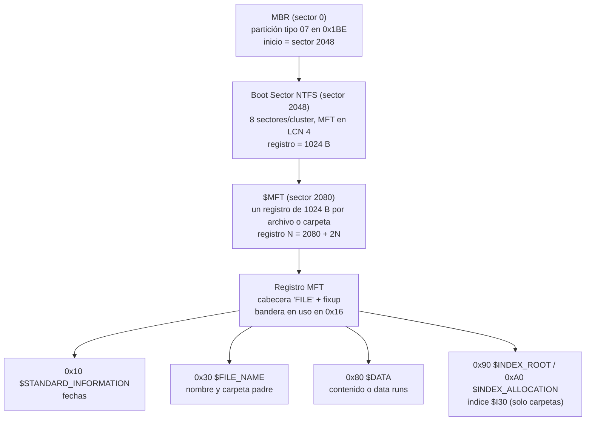
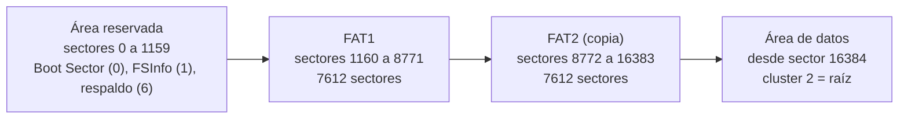
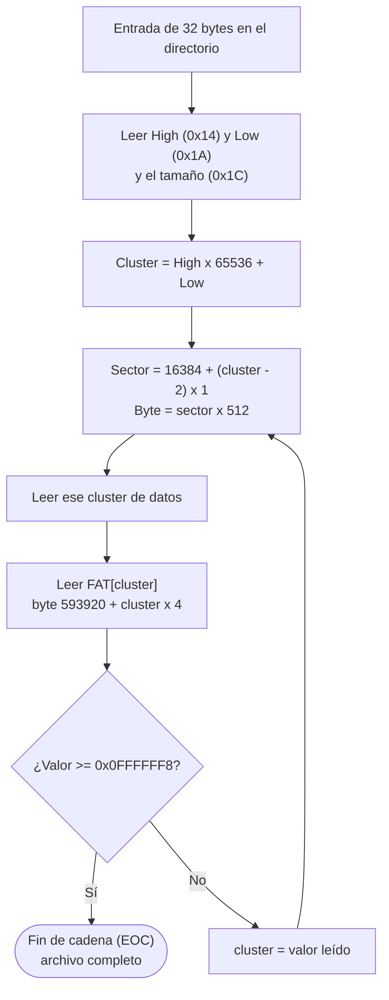
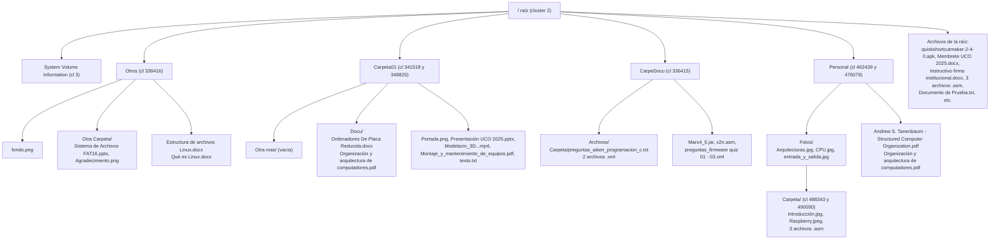
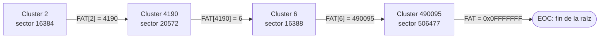
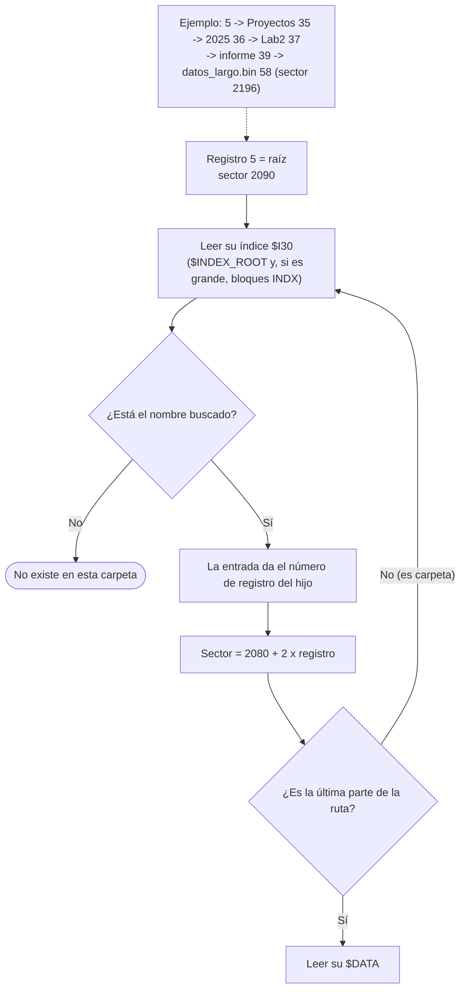
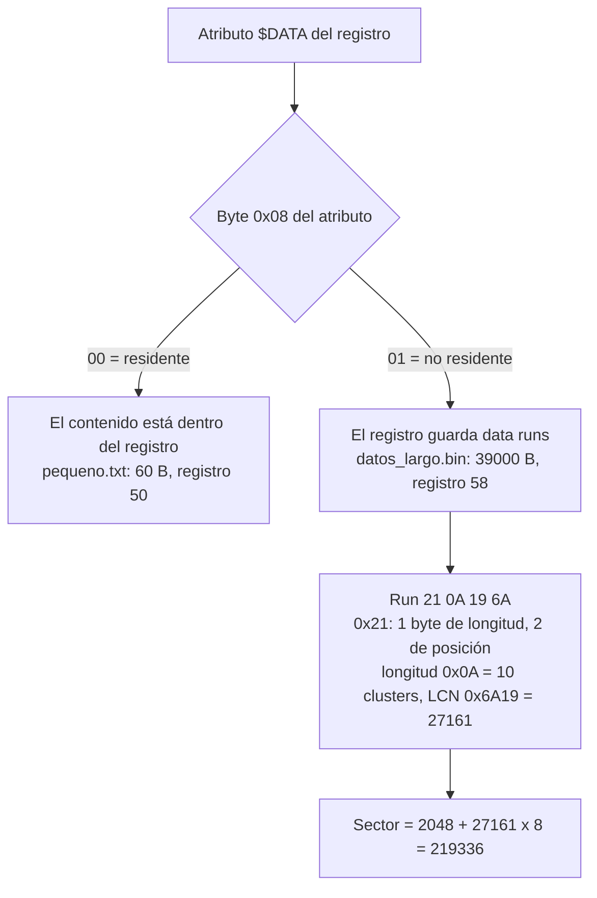
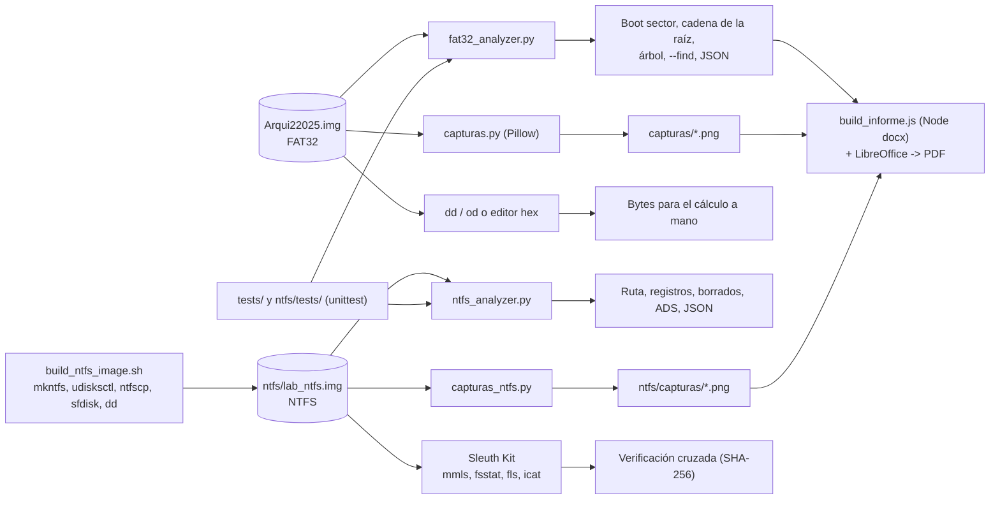

# Guía de estudio – Laboratorio 2 (FAT32 y NTFS)

Guía para preparar la sustentación. Todos los números salen de `resultados_fat32.md`, `ntfs/resultados_ntfs.md`, los scripts y el informe. Si el profesor pregunta un dato, aquí está su origen.

---

## 0. Cómo replicar el ejercicio

Se asume una carpeta con `Arqui22025.img`, `ntfs/lab_ntfs.img` (si existe), `fat32_analyzer.py`, `capturas.py`, `tests/` y los scripts de `ntfs/`. Todos los comandos se ejecutan desde esa carpeta.

**Paso 1. Abrir la imagen en un editor hexadecimal e ir a un offset (en bytes):**

| Qué ver | Offset decimal | Offset hex |
|---|---|---|
| Boot Sector FAT32 | 0 | `0x0` |
| FAT1, entrada del cluster 2 | 593 928 | `0x91008` |
| Raíz (sector 16384) | 8 388 608 | `0x800000` |
| Datos de Documento de Prueba.txt (sector 16440) | 8 417 280 | `0x807000` |
| NTFS: Boot Sector (sector 2048) | 1 048 576 | `0x100000` |
| NTFS: registro 58 (sector 2196) | 1 124 352 | `0x112800` |

- **GHex (Linux):** `ghex Arqui22025.img` y luego menú *Editar → Ir a byte* con el offset.
- **HxD (Windows):** abrir el archivo y usar *Buscar → Ir a* con el offset.
- **xxd (terminal):** `-s` = desde qué byte, `-l` = cuántos bytes.

```bash
xxd -s 0 -l 512 Arqui22025.img                      # Boot Sector
xxd -s $((1160*512 + 2*4)) -l 4 Arqui22025.img      # FAT[2] -> 5e 10 00 00 = 4190
xxd -s $((16384*512)) -l 512 Arqui22025.img         # raíz
xxd -s $((16440*512)) -l 64 Arqui22025.img          # "Esto es un docum..."
xxd -s $((2048*512)) -l 512 ntfs/lab_ntfs.img       # Boot Sector NTFS
xxd -s $((2196*512)) -l 1024 ntfs/lab_ntfs.img      # registro 58
# Si no hay xxd (en este equipo no estaba), lo mismo con od:
od -A d -t x1z -j $((16384*512)) -N 512 Arqui22025.img
```

**Paso 2. Calcular a mano** siguiendo la guía: Boot Sector (3.1) → inicio de datos 16384 (3.2) → entrada de 32 bytes y cluster (3.3) → sector → seguir la FAT (4.1). En NTFS: MBR → Boot Sector → registro 5 → índice → registro del archivo → data run (4.2). Anotar cada valor y compararlo con el editor.

**Paso 3. Comprobar con los scripts y las pruebas:**

```bash
python3 -I fat32_analyzer.py Arqui22025.img                     # boot sector y cadena de la raíz
python3 -I fat32_analyzer.py Arqui22025.img --find pdf jpg jpeg docx apk jar asm
python3 -I fat32_analyzer.py Arqui22025.img --tree
python3 -I -m unittest discover -s tests -v                     # 35 pruebas FAT32

python3 -I ntfs/ntfs_analyzer.py ntfs/lab_ntfs.img --path /Proyectos/2025/Lab2/informe/datos_largo.bin
python3 -I ntfs/ntfs_analyzer.py ntfs/lab_ntfs.img --record 58
cd ntfs && python3 -I -m unittest discover -s tests -v && cd ..  # 18 pruebas NTFS
fls -o 2048 -r -p ntfs/lab_ntfs.img                             # verificación con Sleuth Kit

python3 capturas.py && python3 ntfs/capturas_ntfs.py            # opcional: regenera las figuras (sobrescribe capturas/)
```

Si no existe `ntfs/lab_ntfs.img`, se crea con `bash ntfs/build_ntfs_image.sh` (necesita `mkntfs`, `ntfscp`, `udisksctl`, `sfdisk` e internet). La imagen nueva tendrá otro hash y otras fechas; los números de registro y sector se mantienen salvo que cambie el contenido.

---

## 1. Resumen en 5 líneas

1. Se analizó a mano la imagen **`Arqui22025.img`** (FAT32, 507 201 024 bytes, sin tabla de particiones) leyendo bytes, sin montarla.
2. Se leyó el Boot Sector, se calculó dónde está la raíz (sector **16384**) y se localizaron PDF, JPEG, Word, `.asm`, una aplicación y dos carpetas.
3. Se explicó por qué la raíz "no muestra todo": ocupa **4 clusters no contiguos** (2 → 4190 → 6 → 490095) enlazados en la FAT.
4. Para NTFS se **creó una imagen propia** (`ntfs/lab_ntfs.img`) y se documentó cómo llegar a cualquier archivo recorriendo la MFT.
5. Todo se automatizó con dos scripts de Python (`fat32_analyzer.py`, `ntfs/ntfs_analyzer.py`), con pruebas (35 + 18) y verificación cruzada con The Sleuth Kit.

---

## 2. Conceptos clave (explicados fácil)

### FAT32

| Concepto | Qué es | En nuestra imagen |
|---|---|---|
| **Sector** | La unidad mínima que se lee del disco. | 512 bytes |
| **Cluster** | Grupo de sectores; la unidad mínima que se le asigna a un archivo. | 1 sector = 512 bytes |
| **Little-endian** | Los números de varios bytes se guardan "al revés": el byte menos significativo va primero. | `88 04` se lee `0x0488` = 1160 |
| **Boot Sector** | Sector 0. Trae los "parámetros" del disco (tamaño de sector, de cluster, de la FAT, dónde está la raíz). Termina en la firma `55 AA`. | Sector 0 |
| **FAT** | Tabla con una entrada de 4 bytes por cluster. Cada entrada dice cuál es el **siguiente** cluster del archivo, si está libre (0) o si es el último (≥ `0x0FFFFFF8`). Solo se usan 28 de los 32 bits. | FAT1 en sector 1160, FAT2 en 8772 |
| **Root Directory** | La carpeta raíz. En FAT32 es un directorio normal dentro del área de datos; su primer cluster lo dice el Boot Sector. | Cluster 2 = sector 16384 |
| **Entrada de 32 bytes** | Cada archivo o carpeta ocupa una "ranura" de 32 bytes: nombre 8.3, atributo, cluster inicial (alto y bajo), fechas y tamaño. | 16 ranuras por cluster |
| **LFN** (nombre largo) | Ranuras extra (atributo `0x0F`) que guardan el nombre largo en UTF-16, 13 caracteres por ranura, en orden inverso, justo antes de la entrada 8.3. Llevan un **checksum** del nombre 8.3 para comprobar que pertenecen a esa entrada. | "Documento de Prueba.txt" = 2 ranuras LFN + 1 entrada 8.3 |
| **Cadena de clusters** | La lista de clusters de un archivo, que se obtiene saltando de entrada en entrada en la FAT hasta el fin de cadena. | Raíz: 2 → 4190 → 6 → 490095 → fin |

**Analogía:** la FAT es como un **juego de pistas**: cada cluster te dice dónde está el siguiente. La entrada de directorio te da solo la **primera** pista (el cluster inicial).

Atributos que hay que saber: `0x20` archivo, `0x10` carpeta, `0x0F` ranura LFN, `0x08` etiqueta de volumen. Primer byte `0xE5` = entrada borrada; `0x00` = fin del directorio.

### NTFS

| Concepto | Qué es | En nuestra imagen |
|---|---|---|
| **MBR** | Sector 0 del disco. Tiene la tabla de particiones (en el offset `0x1BE`). | Partición tipo `07` (NTFS) que empieza en el sector **2048** |
| **Boot Sector NTFS** | Primer sector de la partición. Da el tamaño de cluster y dónde empieza la MFT. | Sector 2048; 8 sectores/cluster (4096 B); MFT en el LCN 4 |
| **MFT** (`$MFT`) | La "tabla maestra": **un registro de 1024 bytes por cada archivo o carpeta**. Hasta la propia MFT es el registro 0. La raíz es siempre el **registro 5**. | Empieza en el sector 2080 |
| **Atributos** | Cada registro es una lista de atributos: `0x10` `$STANDARD_INFORMATION` (fechas), `0x30` `$FILE_NAME` (nombre y padre), `0x80` `$DATA` (contenido), `0x90`/`0xA0`/`0xB0` (índices de carpetas). Terminan en `FF FF FF FF`. | – |
| **Residente / no residente** | Si el archivo es pequeño, su contenido va **dentro** del registro (residente). Si no cabe, el registro guarda solo dónde están los datos (no residente). Lo dice el byte `0x08` del atributo: `00` residente, `01` no residente. | `pequeno.txt` (60 B) residente; `datos_largo.bin` (39 000 B) no residente |
| **Data runs** | La "dirección" de los datos no residentes: pares (cuántos clusters, en qué LCN empiezan). El LCN es relativo al run anterior y puede ser negativo. | `21 0A 19 6A` = 10 clusters desde el LCN 27161 |
| **Índice `$I30`** | La lista de contenido de una carpeta, ordenada como árbol B+. Si es pequeña va en `$INDEX_ROOT` (dentro del registro); si crece, pasa a bloques `INDX` de 4096 B en `$INDEX_ALLOCATION`. | `/Muchos` (60 archivos) usa 5 bloques INDX |
| **ADS** (flujo alternativo) | Un archivo puede tener más de un `$DATA`. Los que tienen nombre son "ocultos": el Explorador no los muestra. | `nota.txt:secreto` |
| **Fixup (USA)** | Control de integridad: los 2 últimos bytes de cada sector del registro se reemplazan por un número de control; al leer se restauran. Detecta escrituras a medias. | Registro 58: USN `66 04` |
| **Archivo borrado** | Se pone en 0 la bandera "en uso" del registro (offset `0x16`), se quita del índice de la carpeta y se liberan sus clusters en `$Bitmap`. **Los datos siguen ahí.** | Registros 120 y 121 |

**Analogías:** la MFT es el **fichero de fichas de una biblioteca** (una ficha por libro); el índice `$I30` es el **índice alfabético** de cada estante; los data runs son "**estantes 27161 a 27170**".

Estructura de un registro MFT:



---

## 3. Fórmulas FAT32 con los valores reales

### 3.1 Datos del Boot Sector (sector 0)

| Campo | Offset | Bytes crudos | Valor |
|---|---|---|---|
| Bytes por sector | `0x0B` | `00 02` | `0x0200` = **512** |
| Sectores por cluster (SPC) | `0x0D` | `01` | **1** |
| Sectores reservados | `0x0E` | `88 04` | `0x0488` = **1160** |
| Número de FAT | `0x10` | `02` | **2** |
| Sectores por FAT (SPF) | `0x24` | `BC 1D 00 00` | `0x00001DBC` = **7612** |
| Cluster de la raíz | `0x2C` | `02 00 00 00` | **2** |
| Firma | `0x1FE` | `55 AA` | válida |

Así queda el volumen con estos valores:



### 3.2 Cálculos paso a paso

```
Inicio FAT1      = Reservados                         = 1160
Inicio FAT2      = 1160 + 7612                        = 8772
Inicio de datos  = Reservados + NFAT × SPF
                 = 1160 + 2 × 7612 = 1160 + 15224     = 16384
Sector raíz      = 16384 + (ClusterRaíz − 2) × SPC
                 = 16384 + (2 − 2) × 1                = 16384   → byte 16384 × 512 = 8 388 608
```

**Fórmulas generales:**

```
Cluster inicial = (High << 16) | Low          High en 0x14, Low en 0x1A de la entrada
Sector          = 16384 + (Cluster − 2) × 1
Byte            = Sector × 512
Entrada en FAT  = byte 593 920 + Cluster × 4   (593 920 = 1160 × 512)
```

### 3.3 Ejemplo completo: `Documento de Prueba.txt`

1. En el sector 16384, offset `0x120`, hay dos ranuras LFN: "Prueba.txt" (ordinal `0x42`, la última) y "Documento de " (ordinal `0x01`). Unidas: **Documento de Prueba.txt**.
2. En `0x160` está la entrada 8.3 `DOCUME~2.TXT`, atributo `0x20`.
3. Checksum de `DOCUME~2TXT` = **0x87**, igual en las dos ranuras LFN → el nombre largo es válido.
4. High = `00 00`, Low = `3A 00` → `(0 << 16) | 0x3A` = **58**.
5. Tamaño (`0x1C`): `43 00 00 00` = **67 bytes**.
6. Sector = 1160 + 2 × 7612 + (58 − 2) × 1 = **16440**; byte = **8 417 280**.
7. FAT[58] = `FF FF FF 0F` → fin de cadena: ocupa 1 solo cluster.
8. El sector 16440 empieza con `45 73 74 6F` = "Esto es…".

### 3.4 Ejemplo con High distinto de cero

Carpeta `Carpeta01`: High = `05 00`, Low = `0E 36` → `0x0005360E` = **341518** → sector 16384 + 341516 = **357900**.
Ojo: casi todos los archivos de este disco están por encima del cluster 65535, así que **High casi nunca es 0**.

---

## 4. Cómo se hizo, paso a paso

### 4.1 FAT32

Procedimiento general (sirve para cualquier archivo):

1. Leer el **sector 0** y sacar los 6 parámetros.
2. Calcular el inicio de datos (16384) y el sector de la raíz.
3. Leer las entradas de 32 bytes del directorio. Unir las ranuras LFN y comprobar el checksum.
4. Si la entrada es una **carpeta** (`0x10`), entrar a su cluster y repetir el paso 3.
5. Si es un **archivo**, sacar el cluster inicial `(High << 16) | Low` y el tamaño.
6. Convertir cluster → sector y **seguir la cadena en la FAT** hasta el fin.
7. Comprobar la **firma** (primeros bytes) en el editor hexadecimal.



Cómo se reconoció cada tipo (la firma, o "número mágico", confirma que el archivo es lo que dice ser):

| Tipo | Archivo usado | Cluster | Sector | Firma vista |
|---|---|---|---|---|
| PDF | Organización y arquitectura de computadores.pdf | 408694 | 425076 | `25 50 44 46` = `%PDF-1.3` |
| PDF | Montaje_y_mantenimiento_de_equipos.pdf | 418269 | 434651 | `%PDF-1.4` |
| Aplicación | Mars4_5.jar (en `/CarpeDocu`) | 490097 | 506479 | `50 4B 03 04` = `PK` (ZIP) |
| Aplicación | quickshortcutmaker-2-4-0.apk (raíz) | 59 | 16441 | `PK` (un APK es un ZIP) |
| JPEG | Arquitecturas.jpg | 485655 | 502037 | `FF D8 FF E0 … JFIF` |
| JPEG | CPU.jpg | 486350 | 502732 | `FF D8 FF` |
| Word | Ordenadores De Placa Reducida.docx | 405883 | 422265 | `PK` (un .docx es un ZIP) |
| Word | Instructivo firma institucional.docx | 7 | 16389 | `PK`; **fragmentado**: clusters 7–57 y 345745–346420 |
| ASM | x2n.asm | 498240 | 514622 | texto `.data pi: .float 3.0` |
| ASM | ejemploSuma.asm | 490094 | 506476 | texto `.data opeA: .word 2` |
| Carpeta | Personal | 462439 (→ 476079) | 478821 | entradas `.` y `..` |
| Carpeta | Carpeta01 | 341518 (→ 348825) | 357900 | entradas `.` y `..` |

Datos importantes:
- **No hay `.exe`** en la imagen (ni vivo ni borrado). Por eso la "aplicación" es un `.apk` / `.jar`.
- **No hay `.doc` antiguo**, solo `.docx`. En el nombre 8.3 aparece como `.DOC` porque la extensión corta solo admite 3 letras.
- Totales: 12 carpetas, 39 archivos (4 PDF, 5 DOCX, 5 JPG/JPEG, 7 ASM, 1 APK, 1 JAR…), 3 entradas borradas (todas carpetas).
- Las carpetas `Personal` y `Carpeta01` ocupan **2 clusters no contiguos** cada una: también hay que seguir la FAT en las subcarpetas.

Árbol real de carpetas (resumido):



**Raíz (pregunta del 10 %):**

| Paso | Cluster | Sector | Valor en la FAT | Siguiente |
|---|---|---|---|---|
| 1 | 2 | 16384 | FAT[2] = `5E 10 00 00` | 4190 |
| 2 | 4190 | 20572 | FAT[4190] = `06 00 00 00` | 6 |
| 3 | 6 | 16388 | FAT[6] = `6F 7A 07 00` | 490095 |
| 4 | 490095 | 506477 | FAT[490095] = `FF FF FF 0F` | fin de cadena |

Resultado: 64 ranuras en total → 14 entradas vivas (5 carpetas, 9 archivos), 33 ranuras LFN, 2 borradas, 15 libres.



### 4.2 NTFS

**Cómo se creó la imagen** (`ntfs/build_ntfs_image.sh`, sin `sudo`):

1. `truncate` crea un archivo de 200 MiB y `mkntfs -F -Q -L LABNTFS` lo formatea (cluster 4096 B, registro MFT 1024 B).
2. `udisksctl loop-setup` lo conecta como disco y lo monta automáticamente con el driver **`ntfs3`** del kernel (sin root).
3. Se copian carpetas y archivos: código (`.asm`, `.py`, `.c`), una base SQLite, dos PDF (RFC descargados), JPG de Wikimedia, `putty.exe`, carpetas anidadas a 5 niveles, `/Muchos` con 60 archivos, y dos archivos que luego se **borran** con `rm`.
4. Se desmonta y, fuera de línea, `ntfscp -N secreto` agrega el **ADS** a `nota.txt` (el driver `ntfs3` no maneja ADS).
5. `sfdisk` crea un MBR con una partición tipo `07` en el sector 2048 y `dd` copia la partición en ese offset.
6. `mmls` y `fls` verifican el resultado. Se guarda el SHA-256 en `lab_ntfs.img.sha256`.

**Cómo se recorrió la MFT** (ejemplo `/Proyectos/2025/Lab2/informe/datos_largo.bin`):

1. **MBR** (sector 0), offset `0x1BE`: tipo `07`, inicio `00 08 00 00` = **2048**.
2. **Boot Sector** (sector 2048): 512 B/sector, 8 sectores/cluster, MFT en LCN **4**, `0x40` = `F6` = −10 → registro de 2¹⁰ = **1024 B**.
3. Sector de la MFT = 2048 + 4 × 8 = **2080**. Registro N = **2080 + 2N** (cada registro son 2 sectores).
   Esto vale porque la MFT es contigua: el registro 0 tiene un solo data run (`12 20 01 04` = 288 clusters desde el LCN 4).
4. Registro 5 (raíz), sector 2090 → su índice es grande y apunta a un bloque INDX en el LCN 6405 (sector 2048 + 6405 × 8 = **53288**) → ahí está `Proyectos` = registro 35.
5. Se repite carpeta por carpeta:

| Elemento | Registro | Sector (2080 + 2N) |
|---|---|---|
| Raíz | 5 | 2090 |
| Proyectos | 35 | 2150 |
| 2025 | 36 | 2152 |
| Lab2 | 37 | 2154 |
| informe | 39 | 2158 |
| datos_largo.bin | 58 | 2196 |



6. En el registro 58, `$DATA` es **no residente**, run `21 0A 19 6A`:
   - `0x21` → 1 byte de longitud, 2 bytes de posición.
   - Longitud `0A` = **10 clusters**; posición `19 6A` → `0x6A19` = **27161**.
   - Sector = 2048 + 27161 × 8 = **219336**. Tamaño real 39 000 B (asignado 40 960).



Otros casos documentados: residente (`pequeno.txt`, registro 50), directorio grande (`/Muchos`, registro 59, bloques INDX desde el sector 219416), borrados (registros 120 y 121, recuperados con `icat`, hash coincide) y ADS (`nota.txt`, registro 51).

**Dato del driver `ntfs3`:** los archivos de usuario empiezan en el registro **27**, no en el 64 como con `ntfs-3g`. Y al borrar, `ntfs3` quita el `$FILE_NAME`, por eso Sleuth Kit muestra los borrados como `OrphanFile-120` y `-121`.

---

## 5. Software y herramientas usadas (confirmadas en scripts y documentos)

Mapa de qué entra y qué sale:



| Herramienta | Qué es | Para qué se usó | Comando típico |
|---|---|---|---|
| `dd` + `od` | Utilidades de Linux para copiar bytes y verlos en hexadecimal | Ver sectores y entradas de la imagen FAT32 (**`xxd` no estaba instalado**, se usó `od`) | `dd if=Arqui22025.img bs=512 skip=16384 count=1 \| od -A x -t x1z` |
| Python 3 (`struct`, `argparse`, `json`) | Lenguaje; solo biblioteca estándar | Los dos analizadores | `python3 fat32_analyzer.py Arqui22025.img --tree` |
| `unittest` | Framework de pruebas de Python | 35 pruebas FAT32 y 18 NTFS | `python3 -I -m unittest discover -s tests -v` |
| Pillow (PIL) | Librería de imágenes de Python | `capturas.py` y `ntfs/capturas_ntfs.py` dibujan las "capturas" estilo editor hexadecimal **a partir de los bytes reales**; también generó `logo.png` | `python3 capturas.py` |
| `mkntfs` (ntfs-3g / ntfsprogs) | Formatea en NTFS | Crear el sistema de archivos | `mkntfs -F -Q -L LABNTFS part.img` |
| `ntfscp` (ntfs-3g / ntfsprogs) | Copia datos a un NTFS sin montarlo | Crear el ADS `secreto` | `ntfscp -N secreto part.img secreto.txt /Documentos/nota.txt` |
| `udisksctl` + driver `ntfs3` | Conecta un archivo como disco y lo monta sin root | Llenar la imagen con archivos | `udisksctl loop-setup -f part.img` |
| `sfdisk` | Crea tablas de particiones | Escribir el MBR (partición `07` en el sector 2048) | `sfdisk img <<< 'label: dos …'` |
| `truncate`, `curl`, `sqlite3` (Python) | Crear archivos vacíos, descargar, crear la base | Contenido de la imagen NTFS | `truncate -s 200M part.img` |
| The Sleuth Kit: `mmls`, `fsstat`, `fls`, `icat` | Herramientas forenses | Validar el analizador NTFS: mismos registros y mismo SHA-256 en las 80 entradas | `fls -o 2048 -r -p lab_ntfs.img` / `icat -o 2048 lab_ntfs.img 58` |
| `sha256sum` | Hash de archivos | Probar que la recuperación de borrados es exacta | `icat … 121-128-5 \| sha256sum` |
| Node.js + librería `docx` | Generador de documentos Word | Construir el informe `.docx` (`informe/build_informe.js`) | `node build_informe.js` |
| LibreOffice | Suite ofimática | Convertir el informe a PDF (el PDF dice "Producer: LibreOffice") | `soffice --headless --convert-to pdf …` |
| Mermaid (mermaid-cli) | Diagramas desde texto | Diagramas de los resultados (`informe/diagramas/*.png`) | – |

**Sobre `istat`:** existe en el equipo y se menciona como verificación del ejemplo, pero las pruebas automáticas usan `fls` e `icat`.

**Ojo, honestidad:** las figuras del informe **no son pantallazos de HxD o GHex**. Son imágenes generadas por `capturas.py` que leen los bytes reales de la imagen y los dibujan como un editor hexadecimal. Si el profesor pregunta, se dice así, y se puede mostrar en vivo con `od` o abrir la imagen en un editor hex en el offset indicado.

---

## 6. Cómo funcionan los scripts de Python

### 6.1 `fat32_analyzer.py`

| Función / clase | Qué hace |
|---|---|
| `parse_boot_sector()` | Lee el sector 0 con `struct.unpack_from("<H"…)` (little-endian). Valida la firma `55 AA` y que sea **FAT32** (entradas raíz = 0, sectores/FAT16 = 0, ≥ 65 525 clusters). Si no, lanza `NotFat32Error`. |
| `Fat32._load_fat()` | Carga la FAT1 completa en memoria y la **compara con la FAT2** (`fat_copies_identical`). |
| `fat_entry(c)` | Devuelve FAT[c] con máscara de 28 bits (`& 0x0FFFFFFF`). |
| `follow_chain(start)` | Sigue la cadena. Para en fin de cadena (≥ `0x0FFFFFF8`), cluster defectuoso (`0x0FFFFFF7`), libre (0), fuera de rango o **bucle** (protección con un `set`). |
| `read_directory()` | Recorre todos los clusters de un directorio, de 32 en 32 bytes. Cuenta ranuras vivas, LFN, borradas y libres; junta las LFN pendientes con su entrada 8.3. |
| `lfn_checksum()` | `sum = ((sum & 1) << 7) + (sum >> 1) + byte` sobre los 11 bytes del nombre 8.3. |
| `walk()` / `_recurse()` | Recorre todo el árbol desde la raíz (sin volver a entrar a `.` y `..`). |
| `signature_check()` | Compara los primeros bytes con la firma esperada por extensión (`%PDF`, `FF D8 FF`, `PK`…). |
| `cluster_to_sector()` | `datos + (c − 2) × SPC`. |

Uso:

```bash
python3 fat32_analyzer.py Arqui22025.img                 # boot sector + raíz y su cadena
python3 fat32_analyzer.py Arqui22025.img --tree          # árbol completo + borrados
python3 fat32_analyzer.py Arqui22025.img --find pdf jpg docx apk asm
python3 fat32_analyzer.py Arqui22025.img --json salida.json
python3 fat32_analyzer.py arqui.iso; echo $?             # rechaza: es FAT16 (código 2)
```

### 6.2 `ntfs/ntfs_analyzer.py`

| Función / clase | Qué hace |
|---|---|
| `Volume._find_partition()` | Lee el MBR y busca la partición tipo `07` con `NTFS    ` en su boot sector. |
| `Volume._parse_boot()` | Lee el Boot Sector; interpreta `0x40` con signo (−10 → 2¹⁰ = 1024 B). |
| `apply_fixups()` | Aplica el fixup: comprueba que el final de cada sector tenga el USN y restaura los bytes originales. |
| `decode_runs()` | Decodifica data runs: nibble bajo = bytes de longitud, nibble alto = bytes de posición (con signo, relativa). |
| `record_offset(n)` | Calcula dónde está el registro N **siguiendo los data runs de la propia MFT** (funciona aunque esté fragmentada). |
| `list_dir()` | Lee el índice `$I30`: primero `$INDEX_ROOT`, y si tiene la bandera de "grande", todos los bloques `INDX`. |
| `resolve(path)` | Recorre una ruta carpeta por carpeta desde el registro 5. |
| `deleted()` | Lista registros con bandera "en uso" = 0 que todavía tienen datos. |

Uso:

```bash
python3 -I ntfs/ntfs_analyzer.py ntfs/lab_ntfs.img                  # MBR + boot sector
python3 -I ntfs/ntfs_analyzer.py ntfs/lab_ntfs.img --tree
python3 -I ntfs/ntfs_analyzer.py ntfs/lab_ntfs.img --record 58
python3 -I ntfs/ntfs_analyzer.py ntfs/lab_ntfs.img --path /Proyectos/2025/Lab2/informe/datos_largo.bin
python3 -I ntfs/ntfs_analyzer.py ntfs/lab_ntfs.img --deleted
```

### 6.3 Qué prueban los tests

- **FAT32 (35 pruebas, `tests/`):** valores reales del Boot Sector; que FAT1 = FAT2; que Documento de Prueba.txt está en el sector 16440; que la cadena de la raíz es fragmentada y todos los LFN son válidos; firmas reales; checksum LFN (valor 0x87); fórmula cluster → sector; `(High << 16) | Low`; que rechaza `arqui.iso` (FAT16), imágenes vacías y archivos inexistentes; una **imagen sintética** creada en la prueba (LFN repartido en dos clusters, subcarpetas, borrados, cadena fragmentada, JSON); casos límite de la cadena (bucle, cluster defectuoso, fin de cadena, libre, fuera de rango).
- **NTFS (18 pruebas, `ntfs/tests/`):** data runs (offset negativo, run disperso); fixups (incluido detectar una escritura a medias); boot sector; registro 0 y raíz; índice grande vs. residente; residente vs. no residente; ADS; borrados; recorrido de ruta; JSON; y **comparación con Sleuth Kit**: para cada uno de los 80 archivos, mismo número de registro que `fls` y mismo SHA-256 que `icat`. Esas pruebas se saltan si no hay Sleuth Kit instalado.

```bash
python3 -I -m unittest discover -s tests -v
cd ntfs && python3 -I -m unittest discover -s tests -v
```

---

## 7. Banco de preguntas probables

**FAT32**

1. **¿Qué es un cluster y cuánto mide aquí?** — Grupo de sectores, la unidad mínima asignada a un archivo. Aquí 1 sector = 512 B.
2. **¿Cómo calcularon el sector de la raíz?** — 1160 + 2 × 7612 + (2 − 2) × 1 = 16384.
3. **¿Por qué se resta 2 al cluster?** — Las entradas 0 y 1 de la FAT están reservadas; el primer cluster de datos es el 2.
4. **¿Qué es little-endian? Ejemplo.** — Byte menos significativo primero: `BC 1D 00 00` → `0x00001DBC` = 7612.
5. **¿Cómo sacan el cluster inicial?** — `(High << 16) | Low`, con High en `0x14` y Low en `0x1A`. Ej.: `05 00` / `0E 36` → 341518.
6. **(Trampa) ¿Por qué la raíz no muestra todas las entradas?** — Cada cluster tiene solo 16 ranuras, los nombres largos gastan varias, y la raíz sigue en otros clusters (4190, 6, 490095) que están lejos y fuera de orden. Hay que seguir la FAT.
7. **¿Cómo se sabe dónde termina la raíz?** — Cuando la FAT da un valor ≥ `0x0FFFFFF8`. FAT[490095] = `0x0FFFFFFF`.
8. **(Trampa) ¿Por qué hay dos FAT?** — Redundancia: si una se daña, la otra permite recuperar. Comprobamos que son idénticas.
9. **¿Cuántas ranuras usa "Documento de Prueba.txt"?** — 3: dos LFN (13 caracteres cada una) + una 8.3.
10. **¿Para qué sirve el checksum LFN?** — Para confirmar que las ranuras LFN pertenecen a esa entrada 8.3 (aquí 0x87).
11. **¿Cómo saben que un archivo es PDF de verdad?** — Por la firma en su primer sector: `25 50 44 46` = `%PDF`. No por la extensión.
12. **(Trampa) ¿Por qué un .docx empieza con PK?** — Un .docx (y un .apk o .jar) es un archivo ZIP; `PK` es la firma de ZIP.
13. **¿Qué usaron como aplicación? ¿Había .exe?** — No había `.exe`. Usamos `Mars4_5.jar` y `quickshortcutmaker-2-4-0.apk`.
14. **¿Qué es un archivo fragmentado? Ejemplo.** — Sus clusters no son seguidos. El Instructivo .docx: 7–57 y luego 345745–346420.
15. **¿Cómo se ve una carpeta por dentro?** — Es un cluster con entradas de 32 bytes que empieza con `.` (ella misma) y `..` (el padre).
16. **(Trampa) ¿Qué pasa al borrar un archivo en FAT32?** — Se cambia el primer byte del nombre a `0xE5` y se liberan sus clusters en la FAT. Los datos quedan hasta que se sobrescriben. Aquí solo había 3 carpetas borradas y sus clusters ya se habían reutilizado.
17. **(Trampa) ¿Por qué no usaron `arqui.iso`?** — Es **FAT16**, no FAT32 (512 entradas de raíz, cadena `FAT16` en el offset 54). El script la rechaza.
18. **¿Qué son los "Hidden sectors = 237"?** — Un resto de la partición original. No afecta porque la imagen empieza directo en el Boot Sector (byte 0).
19. **¿Por qué hay dos `EJEMPL~1.ASM`?** — Están en carpetas distintas; el nombre 8.3 solo tiene que ser único dentro de cada carpeta.

**NTFS**

20. **¿Cómo crearon la imagen NTFS?** — Con `build_ntfs_image.sh`: `mkntfs`, montaje con `udisksctl` (driver `ntfs3`), copia de archivos, `ntfscp` para el ADS, `sfdisk` + `dd` para el MBR.
21. **¿Por qué la partición empieza en el sector 2048?** — Es la alineación estándar (1 MiB) que pusimos en el MBR con `sfdisk`.
22. **¿Cómo encuentran la MFT?** — Boot Sector: LCN 4 → 2048 + 4 × 8 = 2080. Registro N = 2080 + 2N.
23. **¿Qué registro es la raíz?** — Siempre el 5 (el 0 es la propia MFT).
24. **¿Residente vs. no residente?** — Residente: el contenido está dentro del registro (`pequeno.txt`, 60 B). No residente: el registro solo trae data runs (`datos_largo.bin`).
25. **Decodifiquen `21 0A 19 6A`.** — `0x21`: 1 byte de longitud y 2 de posición. 10 clusters desde el LCN 27161 → sector 219336.
26. **(Trampa) ¿Cuál es el equivalente NTFS al problema de la raíz?** — Cuando una carpeta crece, su índice pasa de `$INDEX_ROOT` a bloques `INDX` en `$INDEX_ALLOCATION` (ej. `/Muchos`, 5 bloques). Hay que leer todos.
27. **¿Qué pasa al borrar en NTFS?** — La bandera "en uso" del registro pasa a 0, se quita del índice y se liberan los clusters en `$Bitmap`. Los datos siguen; los recuperamos con `icat` y el hash coincidió.
28. **¿Qué es un ADS y cómo lo vieron?** — Un segundo `$DATA` con nombre. `nota.txt:secreto`; `fls` lo muestra como `51-128-5`.
29. **¿Para qué sirve el fixup?** — Detectar registros escritos a medias: el final de cada sector debe tener el USN.
30. **(Trampa) Diferencia principal FAT32 vs. NTFS.** — FAT32: tabla de punteros + entradas de 32 B, sin permisos ni journaling. NTFS: todo es un registro en la MFT, nombres UTF-16, archivos residentes, ADS, permisos y journaling.
31. **¿Cómo saben que su analizador NTFS está bien?** — Lo comparamos con The Sleuth Kit: mismos números de registro y mismo SHA-256 en los 80 archivos.
32. **¿Por qué el primer archivo está en el registro 27 y no en el 64?** — Depende del driver: `ntfs3` (el que usamos) empieza en el 27; `ntfs-3g` en el 64.

---

## 8. Sobre el uso de IA (honesto)

- Se usó un asistente de IA (Claude) como **consultor y apoyo**: aclarar conceptos, revisar cálculos, sugerir la organización del documento y repasar redacción y código. Así lo declara el informe.
- Los resultados se **verificaron con herramientas independientes**: `od`/`dd` sobre los bytes, The Sleuth Kit y las pruebas automáticas.
- El documento NTFS inicial tenía volcados que **no eran reales**; por eso se descartaron y se creó una imagen propia con evidencia verificable. Es un buen ejemplo de por qué no se confía ciegamente en lo que genera una IA.

**Lo que cada integrante debe poder explicar solo, sin mirar:**

1. Leer un campo little-endian del Boot Sector y calcular el sector 16384.
2. Calcular el sector de un archivo desde su entrada de 32 bytes (`High`/`Low`, −2, × SPC).
3. Seguir una cadena en la FAT y explicar la raíz de 4 clusters.
4. Qué es una ranura LFN y para qué es el checksum.
5. Cómo se llega de la raíz NTFS (registro 5) a un archivo, y decodificar un data run.
6. Residente vs. no residente, borrado, ADS.
7. Qué hace cada script y cómo se ejecuta.

---

## 9. Chuleta final

```
FAT32 – Arqui22025.img (sin tabla de particiones)
  512 B/sector · 1 sector/cluster · 1160 reservados · 2 FAT × 7612 sectores · raíz = cluster 2
  FAT1 = sector 1160 · FAT2 = 8772 · datos = 1160 + 2×7612 = 16384
  Sector(c) = 16384 + (c − 2)          Byte = sector × 512
  Cluster   = (High@0x14 << 16) | Low@0x1A      Tamaño @0x1C
  FAT[c]    = byte 593920 + c×4 · fin ≥ 0x0FFFFFF8 · 0 = libre · E5 = borrada
  Raíz: 2 → 4190 → 6 → 490095 → FIN   (16 ranuras/cluster, LFN gasta varias)
  Ejemplo: Documento de Prueba.txt → cl 58 → sector 16440 · 67 B · checksum 0x87
  Firmas: %PDF = 25 50 44 46 · JPEG = FF D8 FF · ZIP/docx/apk/jar = 50 4B 03 04 (PK)
  No hay .exe ni .doc · arqui.iso es FAT16 (no sirve)

NTFS – ntfs/lab_ntfs.img (creada por nosotros)
  MBR: partición tipo 07 en sector 2048 · 8 sect/cluster (4096 B) · MFT LCN 4 · registro 1024 B
  MFT = 2048 + 4×8 = 2080 · Registro N = 2080 + 2N · raíz = registro 5
  Sector(LCN) = 2048 + LCN×8
  Ruta ejemplo: 5 → 35 → 36 → 37 → 39 → 58 · run 21 0A 19 6A = 10 cl desde LCN 27161 → sector 219336
  Residente: pequeno.txt (reg 50) · Índice grande: /Muchos (reg 59, 5 INDX)
  Borrados: reg 120 y 121 (en uso = 0, recuperados con icat) · ADS: nota.txt:secreto (reg 51)

Herramientas: Python (stdlib) · dd/od · Pillow (capturas) · mkntfs, ntfscp, udisksctl, sfdisk
              Sleuth Kit (mmls, fsstat, fls, icat) · Node docx + LibreOffice (informe)
Pruebas: 35 FAT32 + 18 NTFS, todas pasan
```
