# Laboratorio 2 – Localización de archivos en NTFS (20 %)

**Procedimiento para localizar archivos, carpetas y su estructura en NTFS**

Todos los valores de este documento fueron leídos de la imagen real `lab_ntfs.img` (bytes crudos, sin montar), con el analizador `ntfs_analyzer.py` y verificados con The Sleuth Kit. Los números de sector son **absolutos desde el inicio del disco**; el volumen NTFS empieza en el sector 2048.

---

## 1. Cómo se creó la imagen

Script: `build_ntfs_image.sh` (idempotente, sin `sudo`).

1. Se crea un archivo de 200 MiB y se formatea con `mkntfs -F -Q -L LABNTFS` (clúster de 4096 B, registro MFT de 1024 B).
2. Se monta de forma rootless con `udisksctl loop-setup` (montaje automático con el driver `ntfs3` del kernel) y se puebla con un árbol realista.
3. Se desmonta, y **fuera de línea** se añade un ADS con `ntfscp -N secreto` (el driver `ntfs3` no expone streams).
4. Se arma el disco final: MBR (`sfdisk`, una partición tipo 0x07 en el sector 2048) + la partición copiada con `dd` en el offset 2048×512.

Contenido:

| Carpeta | Archivos |
|---|---|
| `/Codigo/asm`, `/python`, `/c` | `suma.asm`, `factorial.asm` (MIPS), `hola.py`, `hola.c` |
| `/BaseDatos` | `schema.sql`, `datos.sql`, `universidad.sqlite` (creada con `sqlite3` desde los .sql) |
| `/Documentos` | `rfc9293.pdf`, `rfc9000.pdf` (descargados), `informe.docx` (zip OOXML mínimo), `pequeno.txt` (60 B, residente), `nota.txt` + ADS `:secreto` |
| `/Imagenes` | `tierra.jpg`, `luna.jpg` (Wikimedia Commons), `logo.png` (PIL) |
| `/Aplicaciones` | `putty.exe` (firma `MZ` verificada) |
| `/Proyectos/2025/Lab2/{fuentes,informe}` | anidado a 5 niveles; `datos_largo.bin` (39 000 B, no residente) |
| `/Muchos` | 60 archivos con nombre largo (índice grande) |
| (borrados antes de desmontar) | `Documentos/borrar_me.txt` (58 B) y `Documentos/borrar_grande.bin` (23 800 B) |

Las URL de origen están en `fuentes.txt`. Las descargas funcionaron todas (no se usó ningún respaldo generado, salvo `logo.png`, que es generado con PIL por diseño).

SHA-256 de la imagen entregada (`lab_ntfs.img.sha256`):

```
7276f50f3e6daca8e65535be48b84218ed153d32bc792b433cdbe3748d1c41d2  lab_ntfs.img
```

> Nota: cada ejecución del script produce una imagen distinta (marcas de tiempo y número de serie), por lo que el hash cambia si se reconstruye. Los números de registro y de sector se mantienen salvo que cambie el contenido.

> **Particularidad del driver `ntfs3`:** el primer archivo de usuario cae en el registro MFT **27** (`Codigo`), no en el 64 que asigna `ntfs-3g`. Los registros 12–15 están reservados y 16–23 sin uso; `ntfs3` además crea `$Extend/$Quota`, `$ObjId`, `$Reparse` en los registros 24–26.

---

## 2. Diagramas del procedimiento

### 2.1 Recorrido completo de la búsqueda

Ejemplo: `/Proyectos/2025/Lab2/informe/datos_largo.bin`.

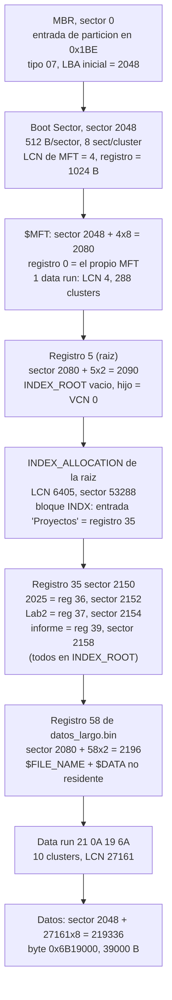

### 2.2 Disposición en disco

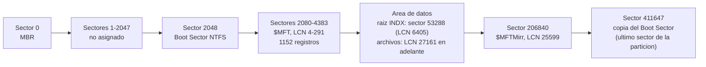

> Los sectores del $MFT mostrados (2080–4383) salen del data run de `$MFT`. La posición de la copia del boot sector en el último sector de la partición (2048 + 409599 = 411647) sigue la convención de NTFS (el campo "total de sectores" no incluye ese sector); se verificó que en ese sector hay un boot sector con `NTFS    `.

### 2.3 Anatomía de un registro MFT (1024 bytes = 2 sectores)

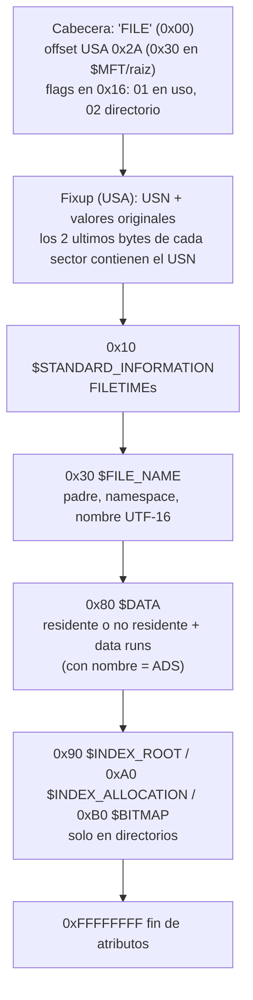

### 2.4 Árbol real de carpetas (con número de registro MFT)

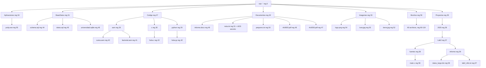

### 2.5 Residente o no residente

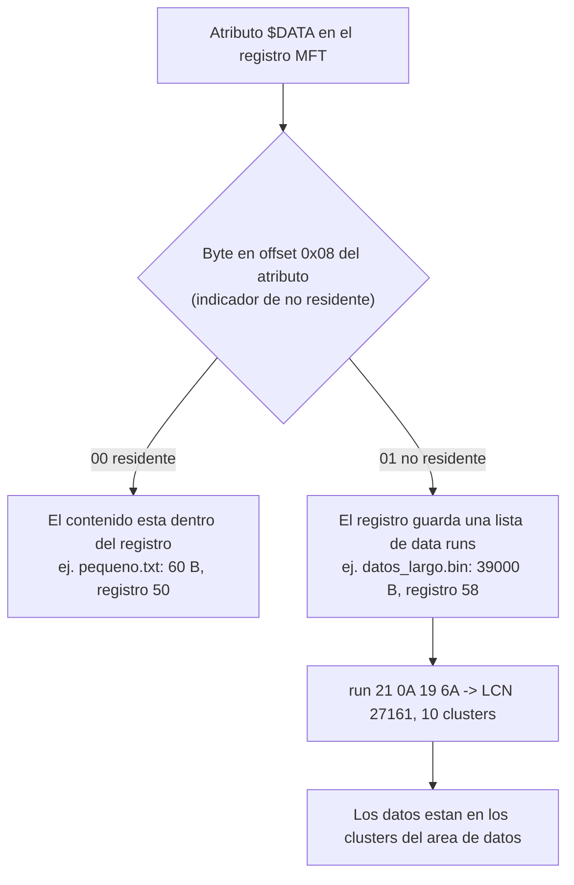

### 2.6 Directorio grande: INDEX_ROOT → INDEX_ALLOCATION

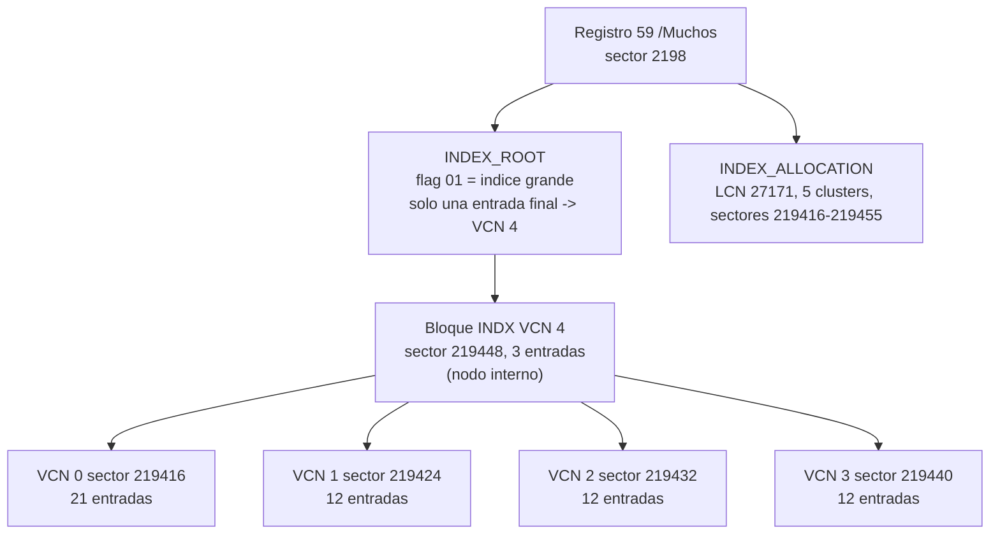

### 2.7 Secuencia del ejemplo trabajado

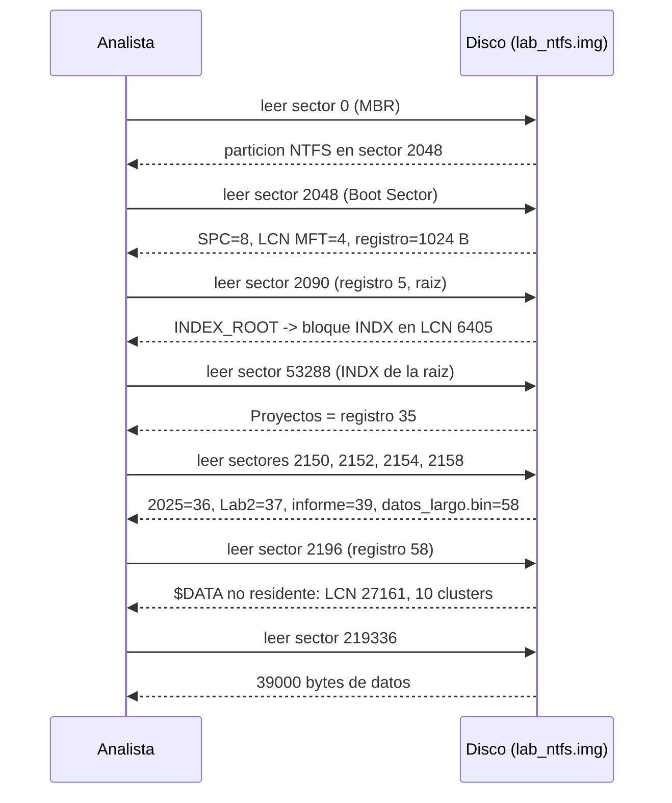

---

## 3. Boot Sector: valores reales y fórmulas

Se lee el sector 2048 (el MBR indica el inicio de la partición).

**MBR, entrada de partición #0** (offset 0x1BE): `00 20 21 00 07 9F 06 19 00 08 00 00 00 40 06 00`

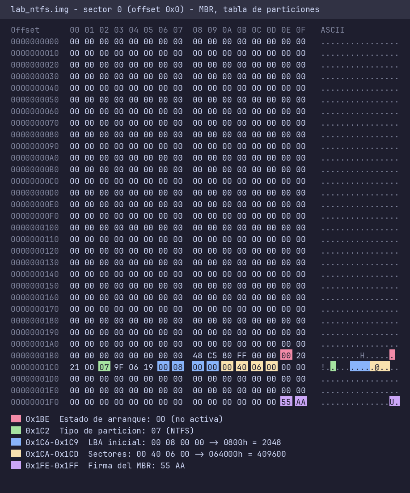

- Tipo: `07` (NTFS).
- LBA inicial: `00 08 00 00` → `00000800h` = **2048**.
- Sectores: `00 40 06 00` → `00064000h` = **409600**.

**Boot Sector NTFS** (formato "bytes → hex → decimal", como en la tabla de FAT32):

| Offset | Campo | Bytes (little-endian) | Hex → decimal |
|---|---|---|---|
| 0x03 | OEM ID | `4E 54 46 53 20 20 20 20` | `'NTFS    '` |
| 0x0B | Bytes por sector | `00 02` | 0200h = 512 |
| 0x0D | Sectores por clúster | `08` | 08h = 8 |
| 0x28 | Total de sectores | `FF 3F 06 00 00 00 00 00` | 63FFFh = 409599 |
| 0x30 | Clúster inicial de $MFT (LCN) | `04 00 00 00 00 00 00 00` | 4h = 4 |
| 0x38 | Clúster inicial de $MFTMirr | `FF 63 00 00 00 00 00 00` | 63FFh = 25599 |
| 0x40 | Clústeres por registro MFT | `F6` | −10 (con signo) → 2¹⁰ = 1024 B |
| 0x44 | Clústeres por bloque de índice | `01` | 1 → 4096 B |
| 0x48 | Número de serie | `3F B0 2D 7F 48 DF 3B 0B` | 0B3BDF487F2DB03Fh |
| 0x1FE | Firma | `55 AA` | válida |

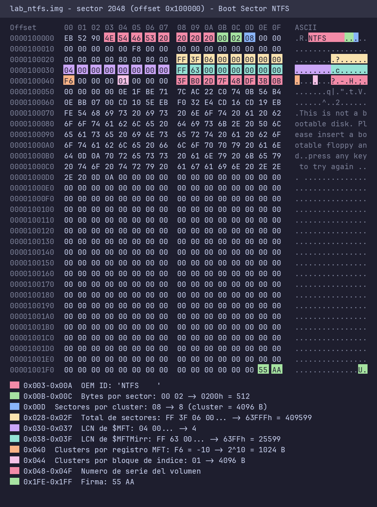

**Fórmulas** (partición en el sector 2048):

- Tamaño de clúster = 512 × 8 = **4096 B**.
- Sector del `$MFT` = 2048 + LCN × SPC = 2048 + 4 × 8 = **2080**.
- Sector de `$MFTMirr` = 2048 + 25599 × 8 = **206840**.
- Sector del registro N = 2080 + N × (1024 / 512) = **2080 + 2N**.

**¿Es válida la fórmula directa?** Solo si `$MFT` es contiguo. Se comprobó leyendo el atributo `$DATA` del registro 0: un único data run `12 20 01 04` → longitud `0120h` = 288 clústeres, LCN 4 (sectores 2080–4383; 288 × 4096 = 1 179 648 B = 1152 registros). Como hay un solo run, la fórmula es exacta para todos los registros de esta imagen. En un disco fragmentado habría que recorrer los runs de `$MFT` (lo que hace el analizador).

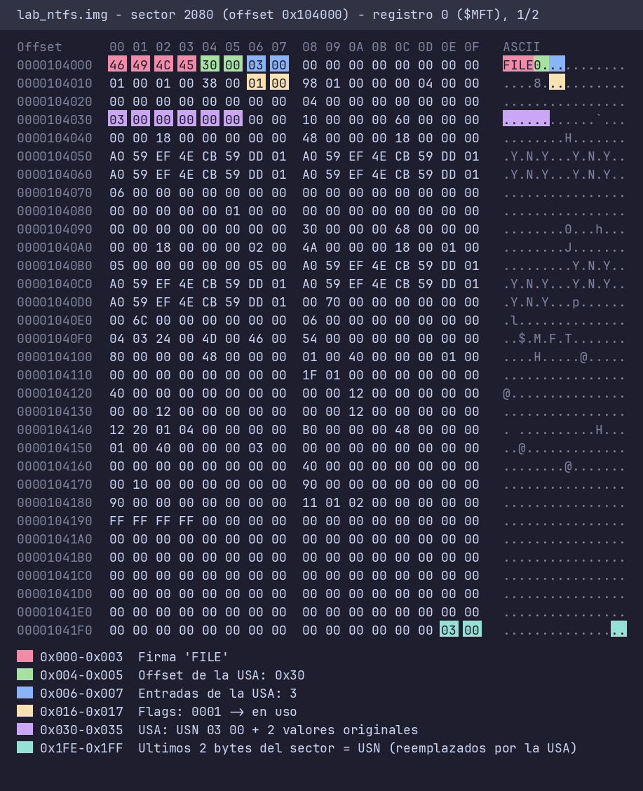

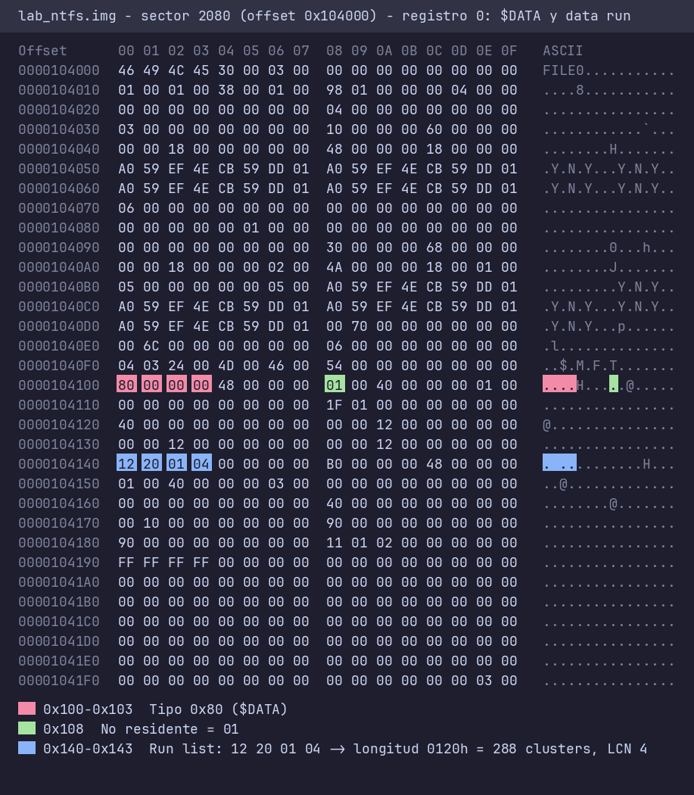

Del registro 0: `FILE`, flags `0001`, USA en 0x30 (USN `03 00`), atributos 0x10, 0x30 (`$MFT`), 0x80, 0xB0.

---

## 4. Ejemplo paso a paso: `/Proyectos/2025/Lab2/informe/datos_largo.bin`

Comando: `python3 ntfs_analyzer.py lab_ntfs.img --path /Proyectos/2025/Lab2/informe/datos_largo.bin`

| Paso | Qué se busca | Registro | Sector (fórmula) | Dónde se halló la entrada |
|---|---|---|---|---|
| 0 | Raíz | 5 | 2080 + 5×2 = **2090** | (registro fijo) |
| 1 | `Proyectos` | 35 | 2080 + 35×2 = **2150** | bloque INDX VCN 0 de la raíz, sector 53288 |
| 2 | `2025` | 36 | 2080 + 36×2 = **2152** | INDEX_ROOT del registro 35 |
| 3 | `Lab2` | 37 | 2080 + 37×2 = **2154** | INDEX_ROOT del registro 36 |
| 4 | `informe` | 39 | 2080 + 39×2 = **2158** | INDEX_ROOT del registro 37 |
| 5 | `datos_largo.bin` | 58 | 2080 + 58×2 = **2196** (offset 0x112800) | INDEX_ROOT del registro 39 |

Cómo se llega al sector 53288: el `INDEX_ROOT` de la raíz (registro 5) tiene el flag `01` (índice grande) y apunta al bloque VCN 0 de su `INDEX_ALLOCATION`, cuyo run es `LCN 6405, 1 clúster` → 2048 + 6405 × 8 = **53288**. Cada entrada de ese bloque trae: referencia al archivo (48 bits bajos = número de registro + 16 bits de secuencia), longitud, y un `$FILE_NAME` con nombre UTF-16.

Contenido del **registro 58** (sector 2196, 464 de 1024 B usados):

- Firma `FILE`, flags `0001` (archivo, en uso), secuencia 1.
- Fixup: USA en 0x2A, 3 entradas, USN `66 04`; los últimos 2 B de cada sector se reponen con los valores originales (`00 00`, `00 00`) y la verificación es correcta.
- `$STANDARD_INFORMATION` (0x10) en 0x30.
- `$FILE_NAME` (0x30) en 0x90: padre = registro 39, namespace 0 (POSIX; `ntfs3` no crea el alias DOS), nombre `datos_largo.bin`.
- `$DATA` (0x80) en 0x108, **no residente**: tamaño real 39000, asignado 40960, run list en +0x40: `21 0A 19 6A` → longitud `0A` = 10 clústeres; LCN `6A19h` = 27161.

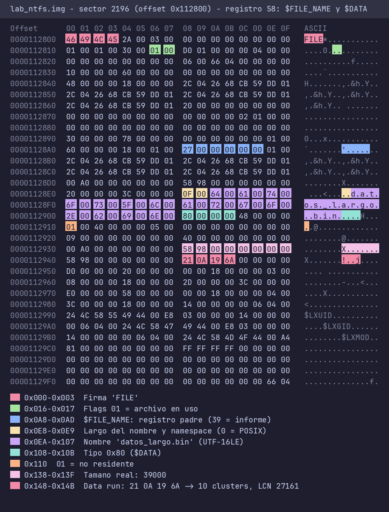

Ubicación de los datos: sector = 2048 + 27161 × 8 = **219336** (byte `0x6B19000`), 10 clústeres = 80 sectores (219336–219415). El archivo ocupa 39000 B, es decir 9,5 clústeres; el último está parcialmente usado (asignado 40960).

Primeros bytes (texto `linea 00000: contenido de relleno NTFS`; este archivo no tiene firma binaria, por eso se muestra su texto):

```
0006B19000  6C 69 6E 65 61 20 30 30 30 30 30 3A 20 63 6F 6E  linea 00000: con
```

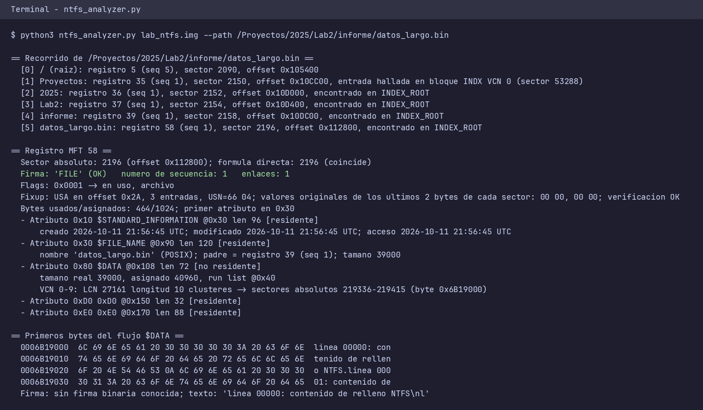

Otra firma verificable: el inicio de `tierra.jpg` (registro 52) comienza con `FF D8 FF E0` y el marcador `JFIF`:

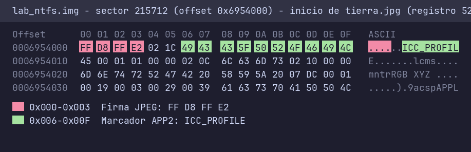

El árbol completo recorrido por el analizador (`--tree`):

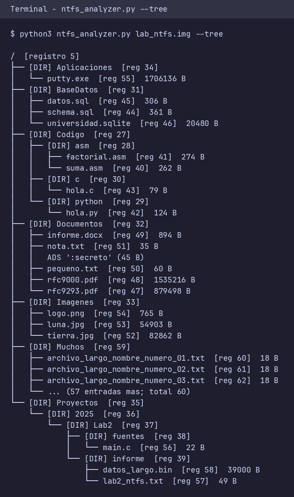

---

## 5. Residente vs. no residente

| Archivo | Registro | $DATA | Dónde están los datos |
|---|---|---|---|
| `Documentos/pequeno.txt` | 50 | **residente**, 60 B, contenido en offset 0x18 del atributo | dentro del propio registro MFT (sector 2080 + 50×2 = 2180) |
| `.../informe/datos_largo.bin` | 58 | **no residente**, 39000 B | clústeres LCN 27161–27170 |

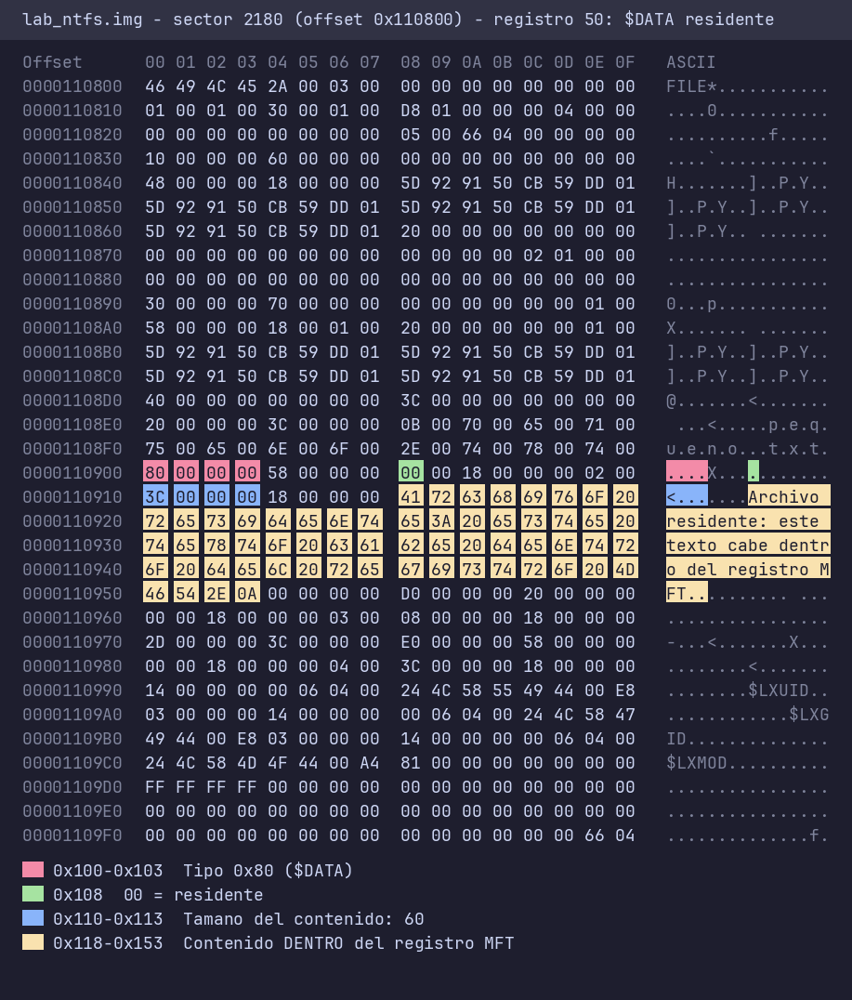

En un atributo residente, el byte en offset 0x08 del encabezado del atributo vale `00`, la longitud del contenido está en 0x10 y su offset en 0x14. En uno no residente vale `01` y la run list está en el offset indicado en 0x20 del atributo (aquí +0x40). En este caso el contenido del archivo se lee directamente del registro: no hay clúster de datos que buscar.

---

## 6. Directorio grande: INDEX_ALLOCATION

En FAT32 la pregunta equivalente es qué ocurre cuando el directorio raíz no cabe en un clúster (entradas que "faltan"): se sigue la cadena FAT. En NTFS el índice `$I30` de un directorio vive primero en el atributo residente `$INDEX_ROOT`; cuando crece, se añade `$INDEX_ALLOCATION` (bloques `INDX` de 4096 B, un árbol B+) y un `$BITMAP` que marca los bloques en uso.

Carpeta `/Muchos` (registro 59, sector 2198, 60 archivos con nombres largos):

- `$INDEX_ROOT`: flag `01` (grande); sin entradas propias salvo la final, que apunta al bloque **VCN 4**.
- `$INDEX_ALLOCATION`: no residente, 20480 B, un run `LCN 27171, 5 clústeres` → sectores 219416–219455.
- Reparto de las 60 entradas por bloque: VCN 0 → 21, VCN 1 → 12, VCN 2 → 12, VCN 3 → 12, VCN 4 → 3 (el nodo interno).
- Bloque VCN 0: sector 2048 + 27171 × 8 = **219416**; cabecera `INDX`, USA con 3 entradas (se aplica fixup también aquí, cada 512 B), VCN 0.

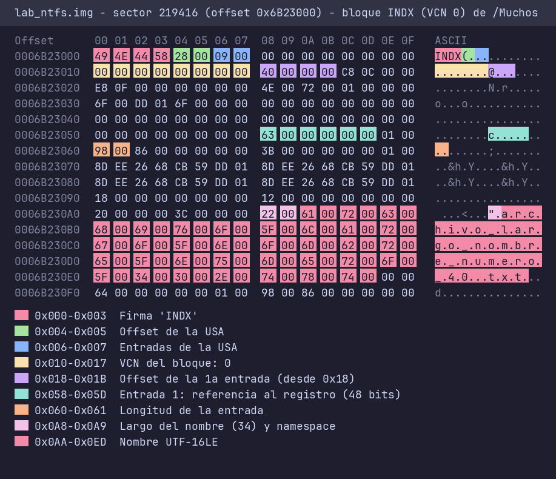

Observación: el analizador lista las 60 entradas recorriendo todos los bloques `INDX`; no hay "entradas perdidas" porque el árbol se completa con los hijos. En esta imagen, además, la raíz (registro 5) y `/Documentos` usan `INDEX_ALLOCATION`; mientras que `/Codigo/asm` y las carpetas del ejemplo trabajado guardan todo en `INDEX_ROOT` (p. ej. el registro 27 tiene flag `00` y 3 entradas).

Raíz (registro 5, `$INDEX_ROOT`):

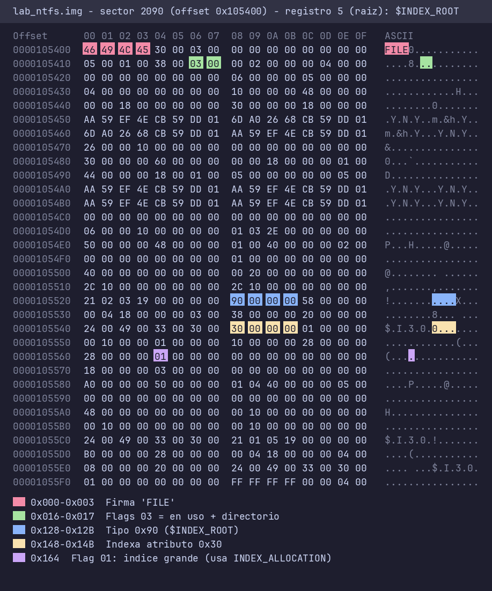

---

## 7. Archivo borrado y recuperación

El script borra con `rm` dos archivos antes de desmontar. En NTFS "borrar" cambia metadatos, no los datos:

- Se quita la entrada del `$I30` de la carpeta padre.
- Se pone a 0 el flag "en uso" del registro MFT (offset 0x16: `01 00` → `00 00`) y los enlaces pasan a 0.
- Se liberan los clústeres en `$Bitmap` (verificado: los bits de LCN 27177–27182 están en 0, mientras que los de LCN 27161–27170 de `datos_largo.bin` están en 1), pero los bytes siguen en disco.

| Registro | Sector | Flags | $DATA | Original |
|---|---|---|---|---|
| 120 | 2320 (2080 + 120×2) | `0000` | residente, 58 B | `Documentos/borrar_me.txt` |
| 121 | 2322 | `0000` | no residente, 23800 B, run `LCN 27177, 6` (sectores 219464–219511) | `Documentos/borrar_grande.bin` |

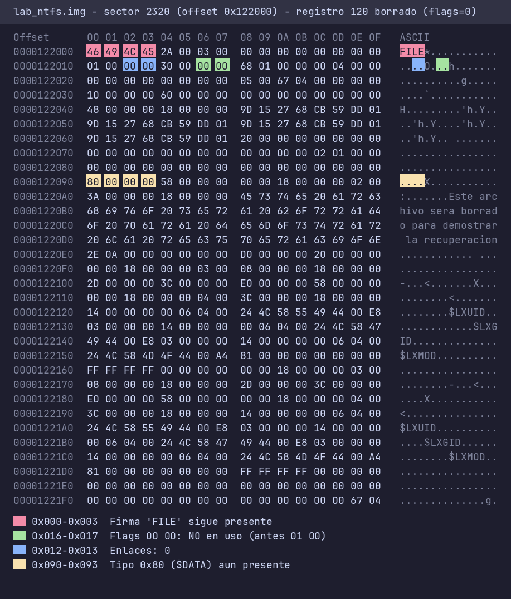

**Hallazgo importante:** el driver `ntfs3` de Linux, al borrar, **elimina también el atributo `$FILE_NAME`** del registro (solo quedan `$STANDARD_INFORMATION`, `$DATA`, `$EA_INFORMATION`, `$EA`). El nombre original no se recupera del registro; Sleuth Kit los muestra como `$OrphanFiles/OrphanFile-120` y `-121`. Con Windows o `ntfs-3g`, el `$FILE_NAME` suele conservarse. Los registros 16–23 también aparecen como huérfanos de TSK, pero están vacíos (no tienen datos) y el analizador los omite.

Recuperación (se verificó el contenido y el hash):

```
$ python3 ntfs_analyzer.py lab_ntfs.img --deleted
  registro 120 ... residente  primeros bytes: b'Este archivo sera borrado para demostrar la recu...'
  registro 121 ... 23800 B [runs (LCN 27177, 6)]  primeros bytes: b'BORRADO 00000: bloque recuperable...'
$ icat -o 2048 lab_ntfs.img 121-128-5 | sha256sum
3a85fe990006d16914c918e03dfe4551df97598064d8a539ef020ce3f15402d0
```

Ese hash coincide con el SHA-256 del contenido original (700 líneas `BORRADO %05d: bloque recuperable`, 23800 B), recalculado de forma independiente. El archivo residente se recupera igual: `icat -o 2048 lab_ntfs.img 120-128-2` imprime la frase original. La recuperación sigue siendo posible solo mientras los clústeres no sean reasignados.

---

## 8. Alternate Data Streams (ADS)

`Documentos/nota.txt` (registro 51, sector 2182) tiene **dos** atributos `$DATA`:

| Atributo | Nombre | Tamaño | Contenido |
|---|---|---|---|
| `$DATA` (id 2) | (sin nombre) | 35 B, residente | `Nota publica del laboratorio NTFS.` |
| `$DATA` (id 5) | `secreto` | 45 B, residente | `contenido oculto en un Alternate Data Stream` |

El flujo con nombre se distingue por el byte "largo del nombre" (offset 0x09 del atributo) = 7 y el nombre `secreto` en UTF-16LE. En el listado, `fls` lo muestra como `nota.txt:secreto` con el mismo inodo (51) y distinto id de atributo (`51-128-5`).

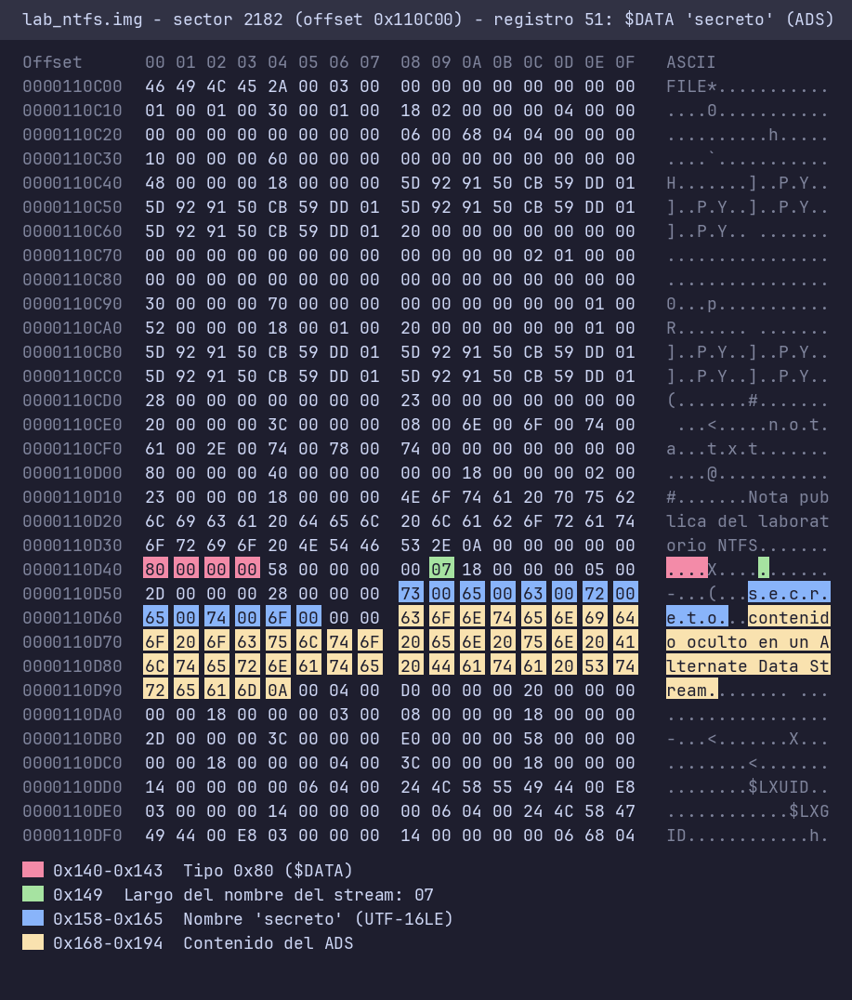

El Explorador y `dir` normales no lo muestran; un análisis forense debe enumerar **todos** los `$DATA` del registro. Su contenido empieza en el offset absoluto `0x110D68`.

---

## 9. Validación con The Sleuth Kit

```
$ mmls lab_ntfs.img
002:  000:000   0000002048   0000411647   0000409600   NTFS / exFAT (0x07)

$ fsstat -o 2048 lab_ntfs.img
Volume Name: LABNTFS
Volume Serial Number: 0B3BDF487F2DB03F
First Cluster of MFT: 4
First Cluster of MFT Mirror: 25599
Size of MFT Entries: 1024 bytes
Cluster Size: 4096

$ fls -o 2048 -r -p lab_ntfs.img | rg 'Proyectos|nota|pequeno'
r/r 51-128-2:   Documentos/nota.txt
r/r 51-128-5:   Documentos/nota.txt:secreto
r/r 50-128-2:   Documentos/pequeno.txt
d/d 35-144-2:   Proyectos
d/d 36-144-2:   Proyectos/2025
d/d 37-144-2:   Proyectos/2025/Lab2
d/d 38-144-2:   Proyectos/2025/Lab2/fuentes
r/r 56-128-2:   Proyectos/2025/Lab2/fuentes/main.c
d/d 39-144-2:   Proyectos/2025/Lab2/informe
r/r 58-128-5:   Proyectos/2025/Lab2/informe/datos_largo.bin
r/r 57-128-2:   Proyectos/2025/Lab2/informe/lab2_ntfs.txt
-/r * 120-128-2: $OrphanFiles/OrphanFile-120
-/r * 121-128-5: $OrphanFiles/OrphanFile-121
```

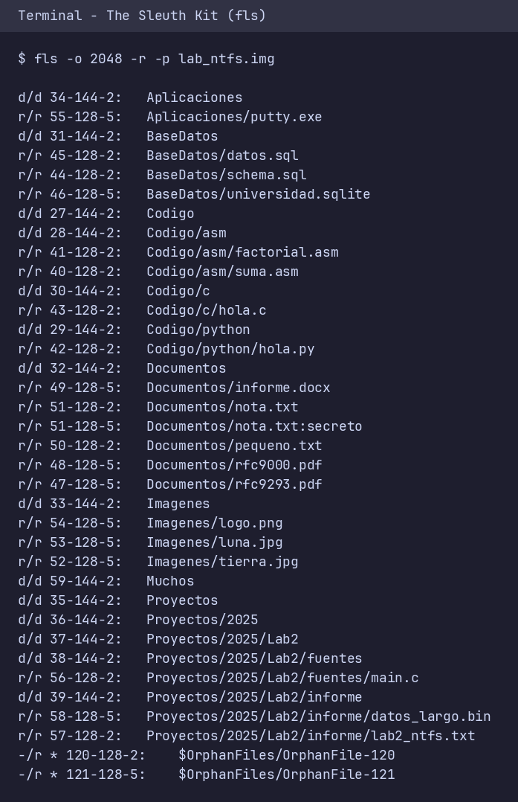

Los números de registro (35, 36, 37, 39, 58) coinciden con los del analizador. Pruebas automáticas (`tests/test_ntfs_analyzer.py`): para **cada** archivo asignado (80 entradas, incluido el ADS) el analizador obtiene el mismo número de registro que `fls` y un SHA-256 del contenido idéntico al de `icat -o 2048 imagen inodo`. Ejemplo: `icat -o 2048 lab_ntfs.img 58 | sha256sum` = `09be007b…724fca`, igual al del analizador. Los registros borrados detectados son un subconjunto de los huérfanos de TSK.

---

## 10. Comparación con FAT32 (breve)

| Concepto | FAT32 | NTFS |
|---|---|---|
| Metadatos | Boot + FAT + directorios | `$MFT`: un registro de 1024 B por objeto |
| Ubicar la raíz | Clúster 2 (campo del boot) | Registro 5 (fijo) |
| Entradas de directorio | 32 B por entrada (8.3 + LFN) | Índice B+ `$I30` (INDEX_ROOT / INDX), nombres UTF-16 |
| Dónde están los datos | Cadena de clústeres en la FAT | Data runs (LCN, longitud) en el registro |
| Archivos pequeños | Siempre en un clúster | Pueden ser residentes en el registro |
| Directorio grande | Cadena de clústeres | `INDEX_ALLOCATION` (árbol de bloques INDX) |
| Borrado | Primer byte de la entrada = E5 | Flag "en uso" = 0 en el registro |
| Streams extra | No | Sí (ADS, varios `$DATA`) |
| Integridad | – | Fixup (USA) en cada sector de registro |

---

## 11. Cómo reproducir

```bash
cd lab2/ntfs
./build_ntfs_image.sh                 # reconstruye lab_ntfs.img (requiere udisksctl, mkntfs, ntfscp, sfdisk)
python3 -I ntfs_analyzer.py lab_ntfs.img                       # MBR + boot sector + fórmulas
python3 -I ntfs_analyzer.py lab_ntfs.img --tree                # árbol desde el registro 5
python3 -I ntfs_analyzer.py lab_ntfs.img --record 58           # detalle de un registro
python3 -I ntfs_analyzer.py lab_ntfs.img --path /Proyectos/2025/Lab2/informe/datos_largo.bin
python3 -I ntfs_analyzer.py lab_ntfs.img --deleted --json salida.json
python3 -I -m unittest discover -s tests -v                    # 18 pruebas
python3 capturas_ntfs.py                                       # regenera capturas/*.png
fls -o 2048 -r -p lab_ntfs.img                                 # verificación cruzada
```

Si se reconstruye la imagen, los hashes y las marcas de tiempo de este documento cambian; los números de registro y sector se mantienen, y las capturas se regeneran con `capturas_ntfs.py`.
