# Laboratorio 2 - Exploración de Discos y FAT32: resultados

Imagen analizada: `Arqui22025.img` (507 201 024 bytes = 990 627 sectores de 512 B, FAT32, sin tabla de particiones: el sector de arranque está en el byte 0).
Todos los valores de este documento fueron obtenidos de la imagen real con `fat32_analyzer.py` y verificados con `dd | od`.

> Nota: `arqui.iso` (misma carpeta) **no es FAT32**: es FAT16 (entradas de raíz = 512, sectores/FAT16 = 242, cadena `FAT16` en el offset 54). El analizador la rechaza con código de salida 2.

## 0. Cómo reproducir

```bash
cd lab2
python3 fat32_analyzer.py Arqui22025.img                       # boot sector, raíz y cadena de la raíz
python3 fat32_analyzer.py Arqui22025.img --tree                # árbol completo + borrados
python3 fat32_analyzer.py Arqui22025.img --find pdf jpg jpeg docx apk exe asm   # detalle por archivo
python3 fat32_analyzer.py Arqui22025.img --json salida.json    # todo en JSON
python3 fat32_analyzer.py arqui.iso ; echo $?                  # rechazo: no es FAT32 (exit 2)
python3 -I -m unittest discover -s tests -v                    # pruebas
```

Ver un sector en el editor hexadecimal (como `xxd` no está instalado se usa `od`):

```bash
# Sector N completo (512 bytes):
dd if=Arqui22025.img bs=512 skip=N count=1 2>/dev/null | od -A x -t x1z
# Una entrada de directorio de 32 bytes a partir de un byte absoluto:
od -A d -t x1z -j <BYTE_OFFSET> -N 32 Arqui22025.img
# Entrada de la FAT del cluster C (FAT1 empieza en el byte 1160*512 = 593920):
od -A x -t x1z -j $((1160*512 + C*4)) -N 4 Arqui22025.img
```

En un editor gráfico (HxD, Okteta, wxHexEditor) use "Ir a offset" con el valor `Offset` de cada tabla (decimal o hexadecimal).

## Diagramas de apoyo

### D1. Distribución del disco (sectores reales)

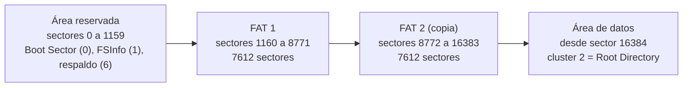

### D2. Procedimiento general para localizar un archivo

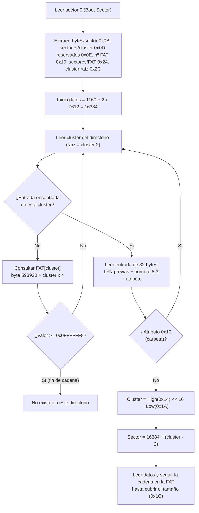

### D3. Cadena real del Root Directory (respuesta del 10 %)

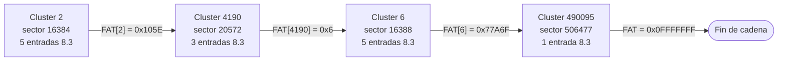

### D4. Anatomía de una entrada de directorio (32 bytes)

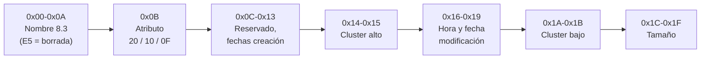

### D5. Reconstrucción del nombre largo (ejemplo real)

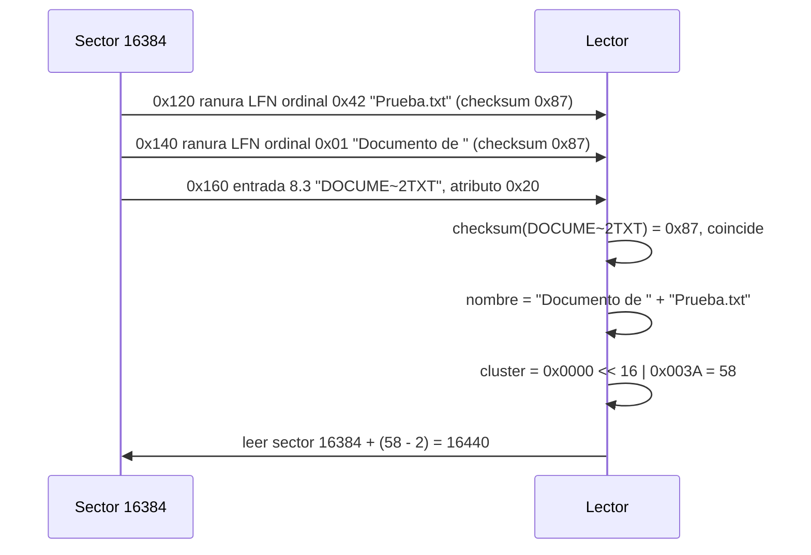

### D6. Estructura real de dos carpetas

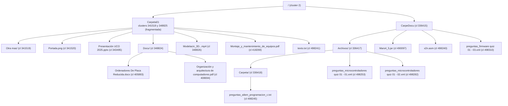

## 1. Sector de arranque (BPB, sector 0)

| Campo | Offset | Bytes crudos (little-endian) | Valor |
|---|---|---|---|
| Bytes por sector | 0x0B (11) | `00 02` | 0200h = **512** |
| Sectores por cluster | 0x0D (13) | `01` | 01h = **1** |
| Sectores reservados | 0x0E (14) | `88 04` | 0488h = **1160** |
| Número de FAT | 0x10 (16) | `02` | **2** |
| Entradas raíz (FAT12/16) | 0x11 (17) | `00 00` | 0 (confirma FAT32) |
| Total sectores 32 | 0x20 (32) | `A3 1D 0F 00` | 000F1DA3h = 990 627 |
| Sectores por FAT | 0x24 (36) | `BC 1D 00 00` | 00001DBCh = **7612** |
| Cluster raíz | 0x2C (44) | `02 00 00 00` | **2** |
| FSInfo / Backup boot | 0x30 / 0x32 | `01 00` / `06 00` | sector 1 / sector 6 |
| Sectores ocultos | 0x1C (28) | `ED 00 00 00` | 237 (heredado de la partición original) |
| Tipo de FS | 0x52 (82) | `46 41 54 33 32 20 20 20` | `FAT32   ` |
| Firma | 0x1FE (510) | `55 AA` | válida |

Zonas derivadas:

| Zona | Cálculo | Sector | Byte |
|---|---|---|---|
| Reservada (arranque, FSInfo, respaldo) | 0 .. 1159 | 0 | 0 |
| FAT 1 | = Reservados | 1160 | 593 920 |
| FAT 2 (idéntica a FAT 1, verificado) | 1160 + 7612 | 8772 | 4 491 264 |
| Área de datos (cluster 2) | 1160 + 2*7612 | 16384 | 8 388 608 (0x800000) |

Clusters de datos: 974 243. 

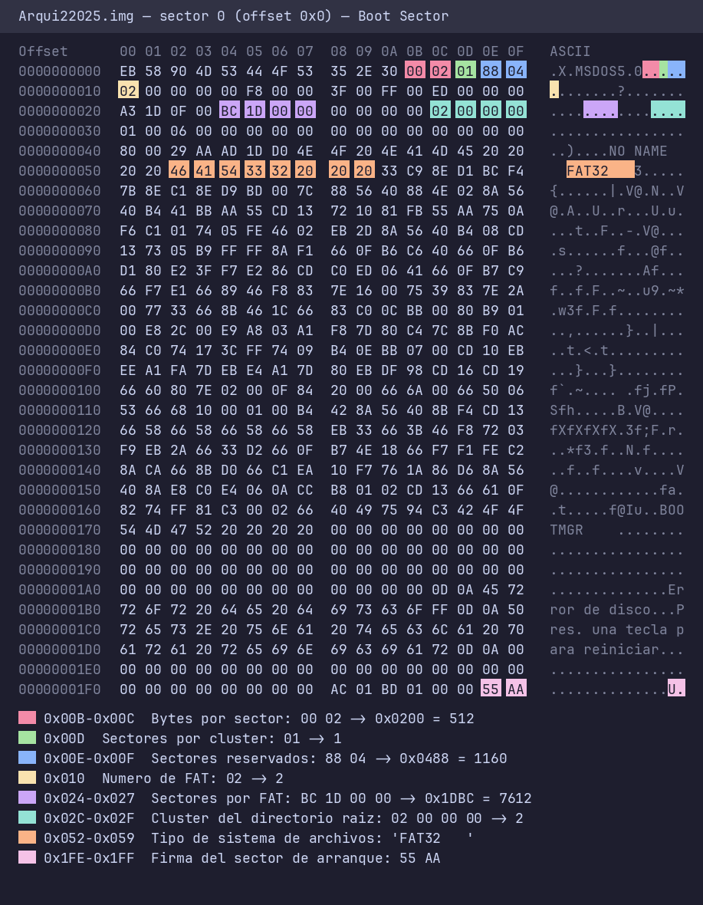

## 2. Ubicación del Directorio Raíz

```
RootSector = Reserved + NFATs*SectorsPerFAT + (RootCluster-2)*SPC
           = 1160 + 2*7612 + (2-2)*1
           = 1160 + 15224 + 0 = 16384
Byte       = 16384 * 512 = 8 388 608 (0x800000)
```

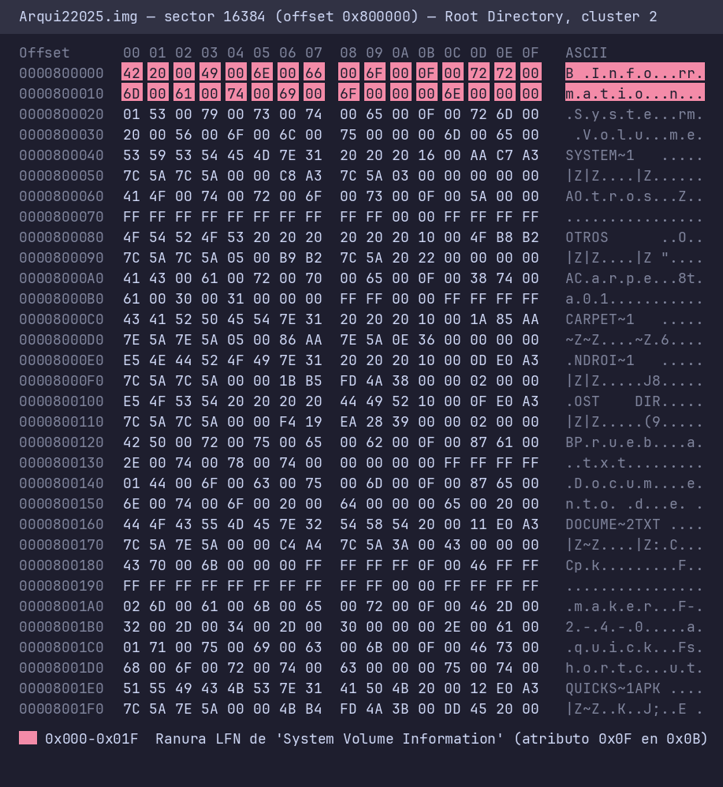

## 3. Pregunta (10 %): por qué la raíz "no muestra todas las entradas" y cómo hallar el resto

**Respuesta.** Con 1 sector por cluster, un cluster = 512 bytes = **16 ranuras de 32 bytes**. En el sector 16384 solo caben 16 ranuras, pero:

1. Cada nombre largo consume `1 + ceil(longitud/13)` ranuras LFN adicionales (+ la entrada 8.3), de modo que unos pocos archivos agotan el cluster.
2. El directorio raíz en FAT32 **no es una región fija**: es una cadena de clusters enlazados en la FAT. Al llenarse el primer cluster, el sistema asigna otro cualquiera libre y lo enlaza.
3. Existen además ranuras borradas (`0xE5`) que no se listan.

**Procedimiento:** leer la entrada de la FAT del cluster actual (offset `1160*512 + cluster*4`) y seguirla hasta un valor >= `0x0FFFFFF8`.

Cadena real de la raíz (evidencia):

| Paso | Cluster | Sector (`1160+15224+(c-2)`) | Byte | Valor en la FAT | Ranuras: vivas 8.3 / LFN / borradas / libres |
|---|---|---|---|---|---|
| 1 | 2 | 16384 | 8 388 608 | FAT[2] = `5E 10 00 00` = 0x105E -> **4190** | 5 / 9 / 2 / 0 |
| 2 | 4190 | 20572 | 10 532 864 | FAT[4190] = 0x6 -> **6** | 3 / 13 / 0 / 0 |
| 3 | 6 | 16388 | 8 390 656 | FAT[6] = `6F 7A 07 00` = 0x77A6F -> **490095** | 5 / 11 / 0 / 0 |
| 4 | 490095 | 506477 | 259 316 224 | FAT[490095] = 0x0FFFFFFF (**fin de cadena**) | 1 / 0 / 0 / 15 |
| **Total** | 4 clusters (fragmentada) | | | | 64 ranuras: 14 / 33 / 2 / 15 |

- 14 entradas 8.3 vivas en la raíz (5 carpetas y 9 archivos) usan 14 + 33 = 47 ranuras; más 2 borradas = 49 de 64 ranuras ocupadas. Un editor que muestre solo el sector 16384 enseña apenas 16 ranuras (5 entradas 8.3 y 9 LFN, 2 borradas): el resto está en los clusters 4190, 6 y 490095, que están **fuera de orden y lejos** del primero.
- Entradas borradas (primer byte `E5`) en la raíz: `?NDROI~1` (clúster 56) y `?OST.DIR` (57), ambas con atributo directorio; además `Personal/Carpeta` (clúster 3688, con LFN cuyo checksum es válido). No existe ninguna entrada borrada de las categorías pedidas (pdf, jpg, exe, doc, asm).
- Comprobación: `python3 fat32_analyzer.py Arqui22025.img` imprime esta tabla en la sección `[3]`.

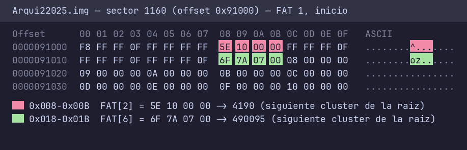

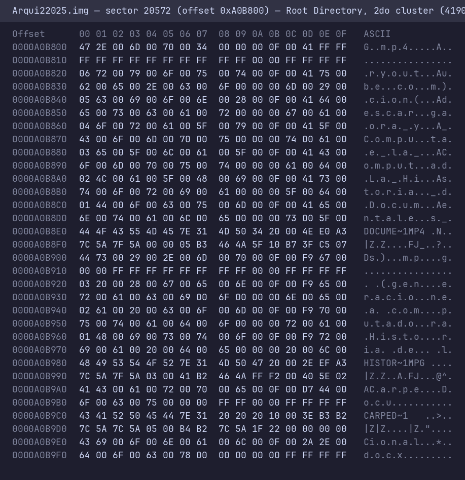

## 4. Cómo leer una entrada de directorio (32 bytes)

| Offset | Tam. | Contenido |
|---|---|---|
| 0x00 | 11 | Nombre 8.3 (0xE5 = borrada; 0x00 = fin del directorio) |
| 0x0B | 1 | Atributos (0x20 archivo, 0x10 carpeta, 0x08 etiqueta, 0x0F = ranura LFN) |
| 0x14 | 2 | Parte alta del cluster inicial (High) |
| 0x16-0x19 | 4 | Hora y fecha de modificación |
| 0x1A | 2 | Parte baja del cluster inicial (Low) |
| 0x1C | 4 | Tamaño en bytes |

Ranura LFN: 0x00 ordinal (0x40 marca la última), 0x01-0x0A 5 caracteres UTF-16, 0x0B = 0x0F, 0x0D checksum del nombre 8.3, 0x0E-0x19 6 caracteres, 0x1C-0x1F 2 caracteres. Las ranuras se guardan en orden inverso, justo antes de la entrada 8.3.
Checksum: `sum = ((sum & 1) << 7) + (sum >> 1) + byte` (mod 256) sobre los 11 bytes del nombre 8.3.

Fórmulas:

```
Cluster      = (High << 16) | Low            (offsets 0x14 y 0x1A)
Sector       = Reserved + NFATs*SPF + (Cluster-2)*SPC = 1160 + 15224 + (Cluster-2)
Byte         = Sector * 512
Entrada FAT  = byte 1160*512 + Cluster*4  (se usan 28 bits; >= 0x0FFFFFF8 = fin; 0x0FFFFFF7 = defectuoso)
```

## 5. Ejemplo paso a paso: `Documento de Prueba.txt`

1. Está en la raíz, cluster 2 (sector 16384). En el offset 0x120 del sector hay dos ranuras LFN:
   `42 50 00 72 00 75 00 65 00 62 00 0F 00 87 61 00 2E 00 74 00 78 00 74 ...` -> "Prueba.txt" (ordinal 0x42 = última) y `01 44 00 6F 00 63 00 75 00 6D 00 0F 00 87 ...` -> "Documento de " (ordinal 0x01). Concatenadas en orden inverso al almacenado: **Documento de Prueba.txt**.
2. Entrada 8.3 (offset 0x160): `44 4F 43 55 4D 45 7E 32 54 58 54 20 ...` = `DOCUME~2.TXT`, atributo `0x20` (archivo, "A").
3. Checksum de `DOCUME~2TXT` = **0x87**, igual al byte 0x0D de ambas ranuras LFN -> la reconstrucción es válida.
4. Cluster inicial: High (0x14) = `00 00`, Low (0x1A) = `3A 00` -> (0 << 16) | 0x003A = **58**.
5. Tamaño (0x1C): `43 00 00 00` = **67 bytes**.
6. Sector del archivo = 1160 + (2*7612) + (58-2)*1 = 1160 + 15224 + 56 = **16440**; byte = 16440 * 512 = **8 417 280** (0x807000; `od` lo confirma).
7. Cadena: FAT[58] = `FF FF FF 0F` -> fin de cadena; 1 cluster (67 bytes <= 512). Contigua.
8. Firma: archivo de texto; el sector 16440 comienza con `45 73 74 6F 20 65 73 20 ...` = "Esto es un docum...".

```bash
dd if=Arqui22025.img bs=512 skip=16440 count=1 2>/dev/null | od -A x -t x1z | head -3
```

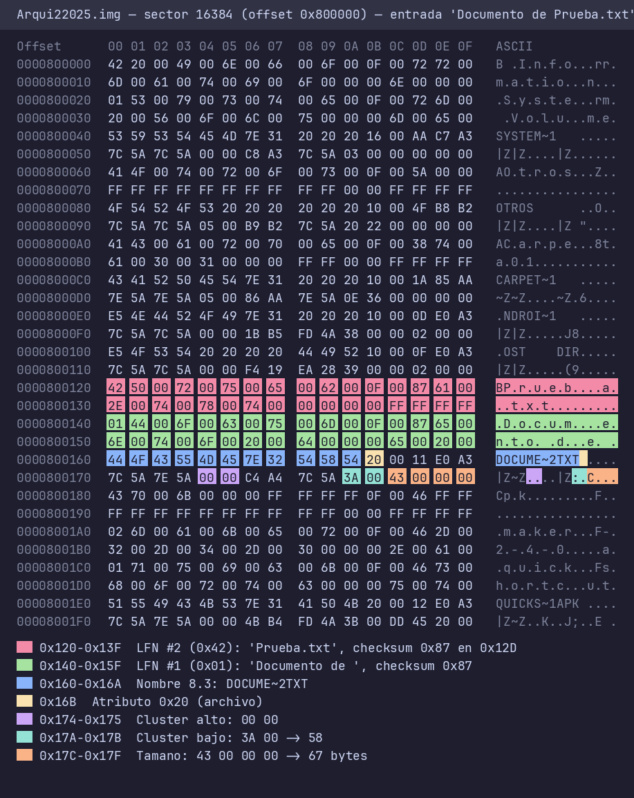

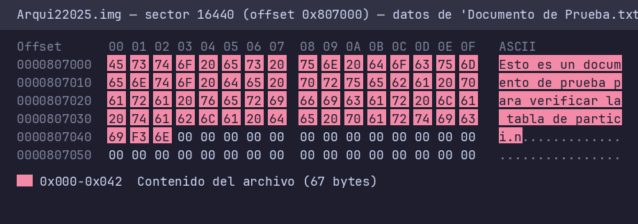

## 6. Archivos por categoría

Convención de columnas: `Cl.` = cluster inicial (High<<16 | Low); `Sector` y `Offset` (byte, decimal) calculados con las fórmulas anteriores; `Cadena` = clusters de la FAT (todos contiguos salvo indicación); firma leída en el primer sector del archivo. Todas las cadenas terminan en fin de cadena (>= 0x0FFFFFF8) y el número de clusters coincide con `ceil(tamaño/512)`.

### 6.1 PDF (4 encontrados, requisito: 2+)

| Ruta | Nombre largo / 8.3 | Chk LFN | Attr | Cl. (High / Low) | Tamaño | Sector | Offset | Cadena | Firma |
|---|---|---|---|---|---|---|---|---|---|
| `/Carpeta01/Docu/` | Organización y arquitectura de computadores.pdf / `ORGANI~1.PDF` | 0x4B | A | 408694 (0x0006 / 0x3C76) | 4 902 329 | 425076 | 217 638 912 | 408694..418268, 9575 | `25 50 44 46` %PDF OK |
| `/Carpeta01/` | Montaje_y_mantenimiento_de_equipos.pdf / `MONTAJ~1.PDF` | 0x4A | A | 418269 (0x0006 / 0x61DD) | 22 614 880 | 434651 | 222 541 312 | 44 170 clusters | %PDF OK |
| `/Personal/` | Andrew S. Tanenbaum - Structured Computer Organization.pdf / `ANDREW~1.PDF` | 0x68 | A | 462441 (0x0007 / 0x0E69) | 6 982 244 | 478823 | 245 157 376 | 13 638 clusters | %PDF OK |
| `/Personal/` | Organización y arquitectura de computadores.pdf / `ORGANI~1.PDF` | 0x4B | A | 476080 (0x0007 / 0x43B0) | 4 902 329 | 492462 | 252 140 544 | 9 575 clusters | %PDF OK |

(Los dos `Organización...pdf` son copias con el mismo nombre 8.3 y checksum en carpetas distintas.)

### 6.2 Aplicación (1: .apk; no hay .exe)

| Ruta | Nombre largo / 8.3 | Chk LFN | Cl. | Tamaño | Sector | Offset | Cadena | Firma |
|---|---|---|---|---|---|---|---|---|
| `/` | quickshortcutmaker-2-4-0.apk / `QUICKS~1.APK` | 0x46 | 59 (0 / 0x003B) | 2 115 037 | 16441 | 8 417 792 | 59 -> 60 -> 61 ... (4131 clusters, contigua) | `50 4B 03 04` PK OK (un APK es un ZIP) |

La entrada de directorio está en el byte 8 389 088 (`od -A d -t x1z -j 8389088 -N 32 Arqui22025.img`). **No existe ningún `.exe` ni `.dll`** (ni vivo ni borrado). Existe además `/CarpeDocu/Mars4_5.jar` (cl. 490097, sector 506479, 8143 clusters, firma PK OK) como aplicación Java.

### 6.3 Imágenes JPEG (5 encontradas: 4 `.jpg` + 1 `.jpeg`)

| Ruta | Nombre largo / 8.3 | Chk LFN | Cl. | Tamaño | Sector | Offset | Clusters | Firma |
|---|---|---|---|---|---|---|---|---|
| `/Personal/Fotos/` | Arquitecturas.jpg / `ARQUIT~1.JPG` | 0xFC | 485655 | 355 589 | 502037 | 257 042 944 | 695 | `FF D8 FF E0 00 10 4A 46` OK |
| `/Personal/Fotos/` | CPU.jpg / `CPU.jpg` (sin LFN; extensión en minúsculas por la bandera NT 0x10 en el offset 0x0C) | - | 486350 | 658 430 | 502732 | 257 398 784 | 1286 | FF D8 FF OK |
| `/Personal/Fotos/` | entrada_y_salida.jpg / `ENTRAD~1.JPG` | 0xA0 | 487636 | 361 501 | 504018 | 258 057 216 | 707 | FF D8 FF OK |
| `/Personal/Fotos/Carpeta/` | Introducción.jpg / `INTROD~1.JPG` | 0x4F | 488344 | 499 893 | 504726 | 258 419 712 | 977 | FF D8 FF OK |
| `/Personal/Fotos/Carpeta/` | Raspberry.jpeg / `RASPBE~1.JPE` | 0xD9 | 489321 | 391 745 | 505703 | 258 919 936 | 766 | FF D8 FF OK |

Todas las cadenas son contiguas. Hay además 3 `.png` (firma `89 50 4E 47` OK).

### 6.4 Word (5 `.docx`; no hay `.doc` antiguo)

| Ruta | Nombre largo / 8.3 | Chk LFN | Cl. | Tamaño | Sector | Offset | Cadena | Firma |
|---|---|---|---|---|---|---|---|---|
| `/Instructivo...` (raíz) | Instructivo firma institucional.docx / `INSTRU~1.DOC` | 0x2A | 7 (0 / 7) | 372 099 | 16389 | 8 391 168 | **fragmentada**: 7..57 y 345745..346420 (727 clusters) | `50 4B 03 04 14 00 06 00` PK OK |
| `/` | Membrete UCO 2025.docx / `MEMBRE~1.DOC` | 0x1F | 346421 | 176 761 | 362803 | 185 755 136 | 346 clusters | PK OK |
| `/Otros/` | Estructura de archivos Linux.docx / `ESTRUC~1.DOC` | 0xD7 | 346767 | 900 697 | 363149 | 185 932 288 | 1760 | PK OK |
| `/Otros/` | Qué es Linux.docx / `QU?ESL~1.DOC` | 0xB9 | 348527 | 152 014 | 364909 | 186 833 408 | 297 | PK OK |
| `/Carpeta01/Docu/` | Ordenadores De Placa Reducida.docx / `ORDENA~1.DOC` | 0x03 | 405883 | 1 439 229 | 422265 | 216 199 680 | 2811 | PK OK |

Observe que la extensión 8.3 se trunca a `DOC` (3 caracteres); solo el nombre largo conserva `.docx`.

### 6.5 Ensamblador `.asm` (7 encontrados, requisito: 2+)

| Ruta | Nombre largo / 8.3 | Chk LFN | Cl. | Tamaño | Sector | Offset | Cadena | Contenido inicial |
|---|---|---|---|---|---|---|---|---|
| `/` | ejemplo-saltos.asm / `EJEMPL~1.ASM` | 0x2C | 490093 | 426 | 506475 | 259 315 200 | 1 cluster | `09 2E 64 61 74 61` = TAB `.data` |
| `/` | ejemploSuma.asm / `EJEMPL~2.ASM` | 0x4C | 490094 | 92 | 506476 | 259 315 712 | 1 | `.data opeA: .word 2` |
| `/` | ejemplo-sumar-enteros.asm / `EJEMPL~3.ASM` | 0xEC | 490096 | 307 | 506478 | 259 316 736 | 1 | `.data text: .asciiz` |
| `/Personal/Fotos/Carpeta/` | ejemplo122024.asm / `EJEMPL~1.ASM` | 0x2C | 490087 | 792 | 506469 | 259 312 128 | 490087 -> 490088 | `.data valor1: .word 14` |
| `/Personal/Fotos/Carpeta/` | ejemplo-ciclo-for.asm / `EJEMPL~2.ASM` | 0x4C | 490089 | 226 | 506471 | 259 313 152 | 1 | `.data text01: .asciiz` |
| `/Personal/Fotos/Carpeta/` | ejemplo-comparar-enteros.asm / `EJEMPL~3.ASM` | 0xEC | 490091 | 865 | 506473 | 259 314 176 | 490091 -> 490092 | `.data text01: .asciiz` |
| `/CarpeDocu/` | x2n.asm / `x2n.asm` (sin LFN) | - | 498240 | 419 | 514622 | 263 486 464 | 1 | `.data pi: .float 3.0` |

Todos son texto sin bytes de control (verificado; contienen acentos en ANSI/UTF-8, p. ej. `F3` = "ó" en `ejemplo-saltos.asm`). Entradas con el mismo 8.3 en carpetas distintas comparten checksum (0x2C, 0x4C, 0xEC): el checksum depende solo del nombre 8.3.

## 7. Carpetas y su estructura completa

Todas las carpetas (12 en total) tienen atributo `0x10`; cada una contiene `.` (su propio cluster) y `..` (cluster del padre, 0 si es la raíz). Árbol completo con `--tree`.

**Carpeta `Personal`** (cl. 462439; **cadena 462439 -> 476079**, fragmentada: su listado crece a 2 clusters)

```
Personal/
├── Fotos/                      (cl. 462440)
│   ├── Arquitecturas.jpg       (cl. 485655, 355 589 B)
│   ├── CPU.jpg                 (cl. 486350, 658 430 B)
│   ├── entrada_y_salida.jpg    (cl. 487636, 361 501 B)
│   └── Carpeta/                (cl. 488343 -> 490090)
│       ├── Introducción.jpg    (cl. 488344)
│       ├── Raspberry.jpeg      (cl. 489321)
│       ├── ejemplo122024.asm   (cl. 490087)
│       ├── ejemplo-ciclo-for.asm (cl. 490089)
│       └── ejemplo-comparar-enteros.asm (cl. 490091)
├── Andrew S. Tanenbaum - Structured Computer Organization.pdf (cl. 462441)
└── Organización y arquitectura de computadores.pdf (cl. 476080)
```

**Carpeta `Otros`** (cl. 336416)

```
Otros/
├── fondo.png                   (cl. 336419, 173 246 B)
├── Otra Carpeta/               (cl. 336758)
│   ├── Sistema de Archivos FAT16.pptx (cl. 336759, 1 733 392 B)
│   └── Agradecimiento.png      (cl. 340145, 702 497 B)
├── Estructura de archivos Linux.docx (cl. 346767)
└── Qué es Linux.docx           (cl. 348527)
```

**Carpeta `Carpeta01`** (cl. 341518 -> 348825) y **`CarpeDocu`** (cl. 336415):

```
Carpeta01/
├── Otra mas/                   (cl. 341519, vacía)
├── Portada.png                 (cl. 341520)
├── Presentación UCO 2025.pptx  (cl. 343495)
├── Docu/                       (cl. 348824)
│   ├── Ordenadores De Placa Reducida.docx (cl. 405883)
│   └── Organización y arquitectura de computadores.pdf (cl. 408694)
├── Modelacin_3D_y_rendering_con_software_de_diseo_BIM_-_20(youtube.com).mp4 (cl. 348826)
├── Montaje_y_mantenimiento_de_equipos.pdf (cl. 418269)
└── texto.txt                   (cl. 498241)

CarpeDocu/
├── Archivos/                   (cl. 336417)
│   ├── Carpeta/preguntas_aiken_programacion_c.txt (cl. 498245)
│   └── preguntas_microcontroladores quiz 01 - 01.xml / - 02.xml
├── Mars4_5.jar, x2n.asm, preguntas_firmware quiz 01 - 03.xml
```

Nota: `Carpeta01` y `Personal` ilustran por qué importa seguir la FAT también en subdirectorios: ambas ocupan 2 clusters no contiguos. Observe también que el valor High del cluster (offset 0x14) es distinto de cero para la mayoría de los archivos de este disco (todos los situados por encima del cluster 65535) (p. ej. `CARPET~1` tiene High = `05 00` y Low = `0E 36` -> 0x0005360E = 341518).

Resumen de la imagen: 12 carpetas, 39 archivos (4 pdf, 5 docx, 2 pptx, 1 apk, 1 jar, 5 jpg/jpeg, 3 png, 7 asm, 3 txt, 3 xml, 2 mp4, 1 mpg, 1 dat, 1 sin extensión), 3 entradas borradas (todas carpetas).

## 8. Verificación con editor hexadecimal (firmas)

| Archivo | Comando | Primeros bytes observados |
|---|---|---|
| PDF (Organización...) | `dd if=Arqui22025.img bs=512 skip=425076 count=1 2>/dev/null \| od -A x -t x1z \| head -2` | `25 50 44 46 2d 31 2e 33` `%PDF-1.3` |
| JPG (Arquitecturas.jpg) | `... skip=502037 ...` | `ff d8 ff e0 00 10 4a 46 49 46` (JFIF) |
| APK | `... skip=16441 ...` | `50 4b 03 04 14 00 08 08` (PK) |
| DOCX (Instructivo) | `... skip=16389 ...` | `50 4b 03 04 14 00 06 00` (PK) |
| ASM (ejemplo122024) | `... skip=506469 ...` | `2e 64 61 74 61 0a 76 61 6c 6f 72 31 3a` `.data.valor1:` |
| TXT (Documento de Prueba) | `... skip=16440 ...` | `45 73 74 6f 20 65 73 20` "Esto es " |

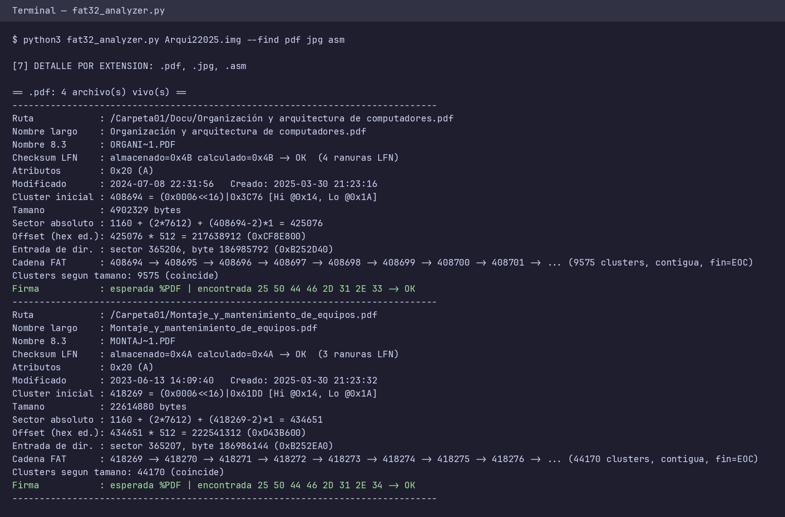

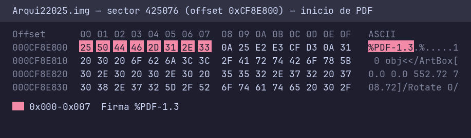

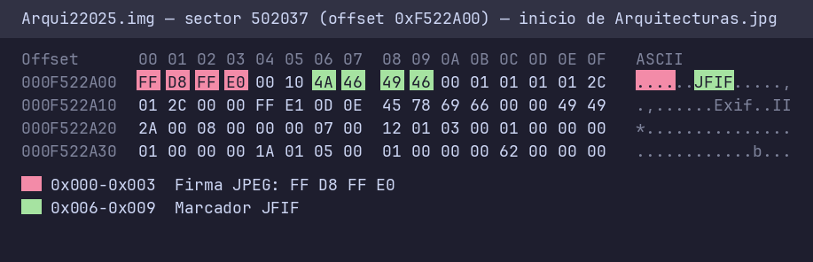

## 9. Hallazgos y limitaciones

- No existen en la imagen: archivos `.exe`/`.dll`, `.doc` (formato binario antiguo). Las entradas borradas son solo 3 carpetas, ninguna de las categorías pedidas.
- Las carpetas borradas `?NDROI~1` y `?OST.DIR` tienen el campo de tamaño en 512 y sus clusters (56, 57) ya fueron reutilizados por otros datos; por eso no se puede recuperar su contenido.
- Nombres 8.3 repetidos en carpetas distintas (p. ej. `EJEMPL~1.ASM`, `PREGUN~1.TXT`) no son colisión: el 8.3 solo debe ser único dentro de cada carpeta.
- Los nombres 8.3 con caracteres no ASCII (p. ej. `QU?ESL~1.DOC`) se decodifican con la página de códigos CP437; el valor exacto del byte (0xC9 en este caso) depende de la página OEM del sistema que escribió el archivo.
- `Hidden sectors = 237` es un residuo de la partición original; no afecta los cálculos porque la imagen se analiza desde el byte 0.


> Las capturas se generan con `python3 capturas.py` a partir de los bytes reales de `Arqui22025.img` (vista estilo editor hexadecimal con los campos resaltados).
