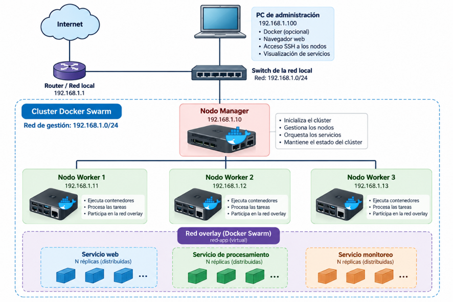

# Guía de trabajo: Laboratorio 2, construcción de un clúster

Plan de trabajo del equipo para resolver el laboratorio. No es el entregable:
el entregable es la **guía de laboratorio** que otro grupo pueda seguir sin
ayuda (ver [Entregable](#entregable)). Este documento ordena qué hacer, en qué
orden y qué evidencia guardar en cada paso.

- Enunciado: [`enunciado/Guia_Laboratorio2_Cluster_v2.docx`](enunciado/Guia_Laboratorio2_Cluster_v2.docx)
- Topología de referencia: [`diagramas/topologia-swarm.png`](diagramas/topologia-swarm.png)
- Evidencias (capturas, salidas de comandos): [`evidencias/`](evidencias/)



## Qué piden, en una línea

Un clúster Docker Swarm de **mínimo 4 nodos** (1 Manager + 3 Workers), con un
servicio replicado accesible desde un cliente, pruebas de escalamiento, falla,
recuperación y nuevo nodo, **todo documentado** con comandos explicados,
evidencias propias y análisis.

## Topología y direccionamiento

Tomada del diagrama. Ajustar a las IP reales del montaje y anotarlas en el
inventario: el enunciado pide documentar los equipos reales, no copiar una
configuración genérica.

| Nodo | Rol | IP | Función |
|---|---|---|---|
| Router | Puerta de enlace | 192.168.1.1 | Salida a Internet |
| PC de administración | Cliente | 192.168.1.100 | SSH a los nodos, navegador, pruebas del servicio |
| manager | Manager | 192.168.1.10 | Inicializa el clúster, orquesta, mantiene el estado |
| worker1 | Worker | 192.168.1.11 | Ejecuta tareas |
| worker2 | Worker | 192.168.1.12 | Ejecuta tareas |
| worker3 | Worker | 192.168.1.13 | Ejecuta tareas |
| worker4 (opcional) | Worker | 192.168.1.14 | Nodo nuevo de la fase 7 |

Red de gestión: `192.168.1.0/24`. Red overlay de la aplicación: `red-app`.

**Si se usan máquinas virtuales:** el adaptador debe ser *Bridge* (o una red
interna/Host-Only compartida por todas). Con *NAT* las VM no se ven entre sí y
Swarm no funciona. Cada nodo necesita IP fija o reservada en el DHCP.

## Reparto sugerido

| Bloque | Responsable | Secciones del entregable |
|---|---|---|
| Teoría | | Introducción, fundamentos, multinúcleo vs. clúster, Docker y Swarm |
| Montaje | | Materiales, red, instalación, creación del clúster |
| Pruebas | | Servicio, escalamiento, fallas, nuevo nodo, tablas |
| Cierre | | Preguntas de análisis, conclusiones, referencias, revisión final |

## Plan por fases

En cada fase hay que guardar en `evidencias/` la captura **con el comando
visible** y anotar qué demuestra. Nombre sugerido: `F3-01-node-ls.png`.

### Fase 1. Red

1. Asignar nombre e IP fija a cada nodo (`hostnamectl set-hostname manager`).
2. Probar conectividad en todas las direcciones: `ping -c 4 192.168.1.11`, etc.
3. Abrir los puertos de Swarm en el firewall de **todos** los nodos:

   | Puerto | Protocolo | Uso |
   |---|---|---|
   | 2377 | TCP | Gestión del clúster (Workers → Manager) |
   | 7946 | TCP y UDP | Comunicación entre nodos |
   | 4789 | UDP | Tráfico de la red overlay (VXLAN) |
   | 8080 (ejemplo) | TCP | Puerto publicado del servicio |

   Con `ufw`: `sudo ufw allow 2377/tcp`, `sudo ufw allow 7946`,
   `sudo ufw allow 4789/udp`.

**Evidencia:** tabla de IP, pings entre nodos, reglas del firewall.
**Explicar:** por qué la comunicación debe ser bidireccional y las IP estables
(los Workers se registran con su IP; si cambia, el Manager pierde el nodo).

### Fase 2. Docker

1. Instalar Docker Engine en cada nodo con la documentación oficial vigente:
   <https://docs.docker.com/engine/install/>.
2. Registrar versiones: `docker version`, `cat /etc/os-release`.
3. Comprobar el servicio: `systemctl status docker`.
4. Prueba básica: `docker run --rm hello-world`.

**Evidencia:** versión de Docker y del sistema operativo en cada nodo.

### Fase 3. Creación del clúster

En el Manager:

```bash
docker swarm init --advertise-addr 192.168.1.10
docker swarm join-token worker   # muestra el comando de unión
```

En cada Worker, el comando que imprimió el Manager:

```bash
docker swarm join --token <TOKEN> 192.168.1.10:2377
```

Verificar en el Manager: `docker node ls`.

**Evidencia:** `docker node ls` con los 4 nodos en estado `Ready`.
**Cuidado:** el token permite unirse al clúster. En el informe se **tapa**.
**Explicar:** el Manager guarda el estado del clúster (Raft) y planifica las
tareas; los Workers solo ejecutan contenedores.

### Fase 4. Servicio replicado

Servicio recomendado: `traefik/whoami`, que responde con el nombre del
contenedor que atendió la petición. Así se ve el balanceo sin escribir código.

```bash
docker network create -d overlay red-app
docker service create --name web --replicas 3 \
  --network red-app -p 8080:80 traefik/whoami
docker service ls
docker service ps web
```

Desde el PC de administración, repetir varias veces:

```bash
curl http://192.168.1.10:8080
```

El campo `Hostname` debe cambiar entre respuestas: el *routing mesh* reparte
las peticiones entre réplicas, sin importar a qué nodo se llame.

**Evidencia:** `service ls`, `service ps`, varias respuestas de `curl` con
hostnames distintos.
**Si se usa imagen propia:** incluir `Dockerfile`, cómo se construye y cómo
llega a todos los nodos (un registro, o `docker save`/`docker load` en cada
nodo).

### Fase 5. Escalamiento

```bash
docker stats --no-stream            # en cada nodo, ANTES
docker service scale web=8
docker service ps web               # ¿en qué nodo quedó cada réplica?
docker stats --no-stream            # en cada nodo, DESPUÉS
docker service scale web=2
```

**Evidencia:** tabla de distribución de tareas por nodo con 3, 8 y 2 réplicas;
CPU y RAM por nodo en las mismas condiciones (misma herramienta, sin carga
extra).
**Explicar:** más réplicas reparten peticiones, pero no aceleran un cálculo.
Para demostrar aceleración haría falta una carga paralelizable y medir tiempos.

### Fase 6. Fallas y recuperación

1. **Falla de un Worker.** Con el servicio en 6 réplicas, en `worker2`:
   `sudo systemctl stop docker` (o apagar la VM). En el Manager, observar
   `docker node ls` y `docker service ps web`: las tareas de `worker2` se
   reprograman en los otros nodos. Medir cuánto tarda y si `curl` falla en
   algún momento.
2. **Recuperación.** `sudo systemctl start docker` en `worker2`. Ver que vuelve
   a `Ready`. Ojo: Swarm **no** rebalancea solo las tareas existentes; para
   repartirlas otra vez: `docker service update --force web`.
3. **Falla del Manager.** Detener Docker en el Manager. Comprobar que los
   contenedores de los Workers siguen respondiendo, pero que no se puede
   administrar (`docker node ls` no funciona en ningún nodo). Con un solo
   Manager no hay alta disponibilidad del plano de control.

Alternativa controlada al paso 1: `docker node update --availability drain worker2`
(saca las tareas sin apagar el nodo) y luego `--availability active`.

**Evidencia:** tabla de pruebas de falla con acción, estado, tiempo de
interrupción medido, recuperación y limitaciones.
**Explicar quorum:** con N Managers, Raft tolera la caída de (N−1)/2. Se
recomienda un número impar (3 o 5). Un Manager extra suelto no garantiza
*failover*.

### Fase 7. Nodo nuevo

1. Preparar `worker4` (fases 1 y 2).
2. Unirlo con `docker swarm join-token worker` y verificar con `docker node ls`.
3. Observar que no recibe tareas hasta escalar o forzar
   (`docker service scale web=10` o `docker service update --force web`).

**Evidencia:** `docker node ls` antes y después; distribución de tareas.

## Tablas que deben aparecer llenas

1. **Inventario:** nodo, rol, CPU, RAM, sistema operativo, IP, estado.
2. **Distribución de tareas:** réplicas por nodo en al menos dos configuraciones.
3. **Recursos:** CPU y RAM por nodo, antes y después de escalar.
4. **Pruebas:**

   | Prueba | Configuración | Resultado observado | Evidencia | Interpretación |
   |---|---|---|---|---|
   | Estado inicial | | | | |
   | Aumento de réplicas | | | | |
   | Reducción de réplicas | | | | |
   | Falla de Worker | | | | |
   | Recuperación | | | | |
   | Nuevo nodo | | | | |

## Preguntas de análisis obligatorias

Responderlas con los datos propios, no con teoría general:

1. ¿Qué limitaciones de una sola máquina multinúcleo motivan la adopción de un clúster en el escenario estudiado?
2. ¿Qué recursos se suman al incorporar un nodo y cuáles no se comparten automáticamente, por ejemplo, la RAM local de cada equipo?
3. ¿Qué diferencia existe entre escalar verticalmente y escalar horizontalmente?
4. ¿Qué ventajas y costos aparecen al distribuir servicios entre varios nodos?
5. ¿Qué evidencias muestran que Swarm distribuyó tareas entre nodos? ¿Qué evidencia faltaría para afirmar que un cálculo se aceleró?
6. ¿Qué ocurrió al detener un Worker? ¿El comportamiento observado coincide con lo esperado? Explique.
7. ¿Qué diferencia existe entre tolerancia a fallos de las tareas y alta disponibilidad del plano de control?
8. ¿Por qué un único Manager no proporciona alta disponibilidad del plano de control, aunque los contenedores de los Workers puedan seguir ejecutándose durante un tiempo?
9. ¿Qué problemas pueden surgir por latencia, ancho de banda, almacenamiento, dependencia de datos o incompatibilidad de arquitectura?
10. ¿Qué partes del procedimiento serían similares al crear un clúster con otra tecnología y cuáles dependen específicamente de Docker Swarm?

## Entregable

Documento técnico en español con estas secciones, en este orden:

1. Portada: título, integrantes, asignatura, fecha.
2. Introducción: problema y alcance.
3. Objetivos generales y específicos.
4. Fundamentos: sistemas distribuidos, nodos, escalabilidad vertical y
   horizontal, paralelismo, balanceo, tolerancia a fallos, tipos de clúster
   (HPC, HA, balanceo, orquestación).
5. Multinúcleo vs. conjunto de nodos: ventajas, costos, límites, cuándo usar cada uno.
6. Docker: contenedores, imágenes, servicios, tareas, Swarm, Manager y Worker.
7. Materiales, versiones, requisitos, topología, IP, puertos, precauciones.
8. Procedimiento paso a paso: por fase, propósito, requisitos, comandos,
   explicación de parámetros, resultado esperado, cómo verificarlo y
   problemas frecuentes. **No se aceptan comandos sin explicación.**
9. Escenarios de prueba, tablas y evidencias numeradas y referenciadas en el texto.
10. Preguntas de análisis, conclusiones (qué se comprobó, qué no, limitaciones)
    y referencias.

Adjuntar `Dockerfile`, scripts o archivos de configuración si se usaron.

### Criterios de evaluación

| Criterio | Peso |
|---|---|
| Fundamentos de arquitectura | 20 % |
| Calidad de la guía (reproducible, comandos explicados, solución de problemas) | 25 % |
| Implementación y validación | 20 % |
| Experimentación y análisis | 20 % |
| Evidencias, presentación y referencias | 15 % |

### Sustentación

Demostrar en vivo: clúster funcionando, distribución de tareas, escalamiento y
al menos una prueba de falla controlada. Ensayar el guion antes con
`docker node ls`, `docker service ps web`, `curl` en bucle y la detención de
un Worker.

## Precauciones

- Pruebas de falla solo en el laboratorio y con autorización.
- No publicar el puerto 2377 en redes no confiables ni mostrar tokens en el informe.
- Documentar versiones exactas; instalar desde la documentación oficial vigente.
- No prometer continuidad sin cortes: medir y reportar lo que pase.

## Referencias iniciales

- Docker. (s. f.). *Swarm mode*. <https://docs.docker.com/engine/swarm/>
- Docker. (s. f.). *Deploy services to a swarm*. <https://docs.docker.com/engine/swarm/services/>
- Docker. (s. f.). *Administer and maintain a swarm of Docker Engines*. <https://docs.docker.com/engine/swarm/admin_guide/>
- Docker. (s. f.). *Use overlay networks* (puertos requeridos). <https://docs.docker.com/engine/network/drivers/overlay/>
- Tanenbaum, A. S., & van Steen, M. (2017). *Distributed systems: Principles and paradigms* (2nd ed.). CreateSpace.

## Lista de control

- [ ] Inventario real de los 4 nodos (CPU, RAM, SO, IP)
- [ ] Conectividad y firewall verificados
- [ ] Docker instalado y versión registrada en cada nodo
- [ ] Swarm creado, 4 nodos `Ready`
- [ ] Servicio replicado accesible desde el cliente
- [ ] Escalamiento: tablas con al menos dos configuraciones
- [ ] Falla de Worker y recuperación medidas
- [ ] Prueba del Manager documentada
- [ ] Nodo nuevo incorporado (si hay recursos)
- [ ] 10 preguntas de análisis respondidas con datos propios
- [ ] Conclusiones y referencias
- [ ] Capturas numeradas, legibles y sin tokens
